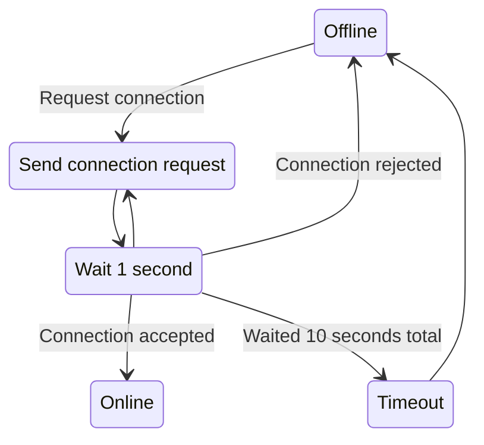
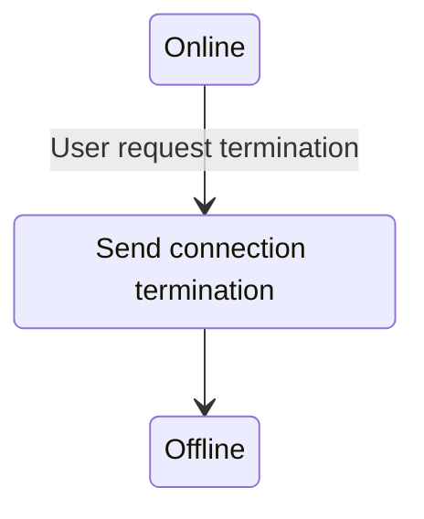
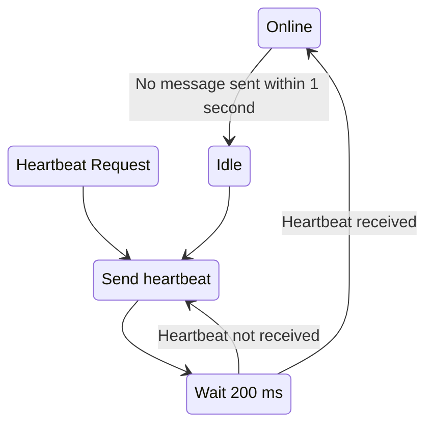

# RFC

## Résumé

ce que fait le protocole, en quelques lignes

## Conventions

référence à la RFC 2119, ordre des octets, notation utilisée

This section will go over the conventions used in this document. It will define how a given value is written.

### Numbers

- **Binary**: Any value with the prefix `0b` is displayed as a binary value.
- **Hexadecimal**: Any value with the prefix `0x` is displayed as a hexadecimal value.
- **Decimal**: Any value without a prefix is displayed as a decimal value.
- **Numeration**: Any single digit decimal number written into text is displayed as their spelled out counter-part, succeeded by their decimal representation written within parentheses. 
- **Calculated Number**: Any value resulting from a calculation is displayed as a decimal, written as code.

### Binary Arrangement

The protocol uses the [little-endian](https://en.wikipedia.org/wiki/Endianness) format.

### Packet Format

This document displays packets using a custom format.

#### Rules

- Each field is displayed in order
- Each field must have the starting bit offset above the box and to its most left
- Each field must have the ending bit offset above the box and to its most right
- Each offset must start from the start of the packet
- The box with a starting or ending offset that exceeds a multiple of 128 creates and starts a new row under the previous row
- Each field must display their name within the box
- Box must be at least as long as the name, with a padding on the left and the right
- Each field is displayed using a box defined with ASCII characters
- Corners of the box must use the `+` symbol
- Vertical sides of the box must use the `|` symbol
- Horizontal sides of the box must use the `-` symbol

#### Examples

The example will display the format of a packet with the following fields:
- Type: 8 bits
- Id: 32 bits
- Checksum: 32 bits
- Value: 64 bits
- Length: 16 bits
- Deep Checksum: 64 bits
- Signature: 40 bits
- Unused: 1 bit

```
 0    7 8 39 40      71
+------+----+----------+
| Type | Id | Checksum |
+------+----+----------+

 72  135 136  151 152         215 216     255
+-------+--------+---------------+-----------+
| Value | Length | Deep Checksum | Signature |
+-------+--------+---------------+-----------+

 256  257
+--------+
| Unused |
+--------+
```

## Terminology

This section will go over the terminology used in this document. It will define what certain terms mean in the context of this document.

- **MUST**: Defines a behavior that is required to be implemented. The protocol will not work properly if the behavior is missing or altered.
- **MUST NOT**: Defines a behavior that is required to be missing. The protocol will not work properly if the behavior is implemented.
- **SHOULD**: Defines a suggested behavior. The protocol will work if a behavior is implemented or not. However, the protocol assumes that the suggested behavior is the one used. A custom behavior will not be able to be used by the protocol.
- **COULD**: Defines a potential behavior. The protocol will work if a behavior is implemented or not. The protocol will assume that no implementation was defined, and the behavior will be ignored.
- **Upper [X]**: Defines the first instance of `[X]` starting from the most significant bit.
- **Lower [X]**: Defines the first instance of `[X]` starting from the least significant bit.
- **Tayste**: Defines a group of two (2) consecutive bits.
- **Nybble**: Defines a group of four (4) consecutive bits.
- **Request**: Defines a packet sent from a client to a server.
- **Response**: Defines a packet sent from a server to a client in response to a prior request.
- **Push**: Defines a packet sent from a server to a client without a prior request.
- **Exchange**: Defines a packet sent from either a server or a client to the other. A client will send to a server, and a server will send to a client.

définition des termes employés (connexion, pair, paquet de données, paquet de contrôle, etc.).

## Vue d’ensemble

fonctionnement général, rôles du client et du serveur.

## Headers

This section will go over the headers that can be shared between multiple packets. Each header defines a packet format, a description for each of their fields and examples if appropriated.

### `PACKET_TYPE`

This section defines the shared common header between all packets. All packets **MUST** start with the header. Each
packet is subjected to the rules of this header.

#### Format

```
 0      7
+--------+
|  Type  |
+--------+
```

#### Fields

| Name | Size             | Description                                         |
|------|------------------|-----------------------------------------------------|
| Type | 8 bits, unsigned | Magic number used to define the type of the packet. |

The field `Type` **MUST NOT** be `0x0`. Any type associated with a packet type **MUST** be supported. An unsupported type **SHOULD** be ignored.

### `MISSING_MESSAGES`

This section defines a shared header that allows to notify of missing messages. Upon receiving a packet with this header, the server **MUST** respond. Upon receiving a packet with this header, the client **MUST** respond.

#### Format
```
 0                       7 8               71
+-------------------------+------------------+
| Last Message Identifier | Missing Messages |
+-------------------------+------------------+
```

#### Fields

| Name     | Size               | Description                                               |
|----------|--------------------|-----------------------------------------------------------|
| Last Message Identifier | 8 bits, unsigned | Identifier of the last message broadcasted. **COULD** be reused in other messages. |
| Missing Messages | 64 bits, unsigned | Flags defining if a previous message was received. |

The field `Missing Messages` **MUST** be ordered starting from the least significant bit to the most significant bit. The offset from the least significant bit defines the offset from the field `Last Message Identifier`. If the field `Last Message Identifier` is greater than `64`, the field `Missing Messages` **MUST** stop after `64` bits.  If the field `Last Message Identifier` is less than `64`, the field `Missing Messages` **MUST** stop after `n` bits, where `n` is the value of `Last Message Identifier`.

#### Examples

Example of the header:

```
36							Last Message Identifier
00 00 01 00 00 00 20 39		Missing Messages
```

Example of how the missing messages with the identifiers `53`, `50`, `49`, `48`, `40` and `13` from the last message with the identifier `54` are requested:
```
Bytes: 36 00 00 01 00 00 00 20 39
Bits: 0 0 1 1 0 1 1 0 0 0 0 0 0 0 0 0 0 0 0 0 0 0 0 0 0 0 0 0 0 0 0 1 0 0 0 0 0 0 0 0 0 0 0 0 0 0 0 0 0 0 0 0 0 0 0 0 0 0 1 0 0 0 0 0 0 0 1 1 1 0 0 1

Grouped Bits:
	- Last Message Identifier: 0 0 1 1 0 1 1 0
	- Missing Messages: 0 0 0 0 0 0 0 0 0 0 0 0 0 0 0 0 0 0 0 0 0 0 0 1 0 0 0 0 0 0 0 0 0 0 0 0 0 0 0 0 0 0 0 0 0 0 0 0 0 0 1 0 0 0 0 0 0 0 1 1 1 0 0 1

Last Message Identifier: 54
Missing Messages:
	0   0  0  0  0  0  0  0  0  0  0 0 0 0 0 0 0 0 0 0 0  0  0  1  0  0  0  0  0  0  0  0  0  0  0  0  0  0  0  0  0  0  0  0  0  0  0  0  0  0  1  0  0  0  0  0  0  0  1  1  1  0  0  1 
	-10 -9 -8 -7 -6 -5 -4 -3 -2 -1 0 1 2 3 4 5 6 7 8 9 10 11 12 13 14 15 16 17 18 19 20 21 22 23 24 25 26 27 28 29 30 31 32 33 34 35 36 37 38 39 40 41 42 43 44 45 46 47 48 49 50 51 52 53
	|____________________________|                              |                                                                                |                       |  |  |        |
				  |                                             \________________________________________________________________________________|_______________________|__|__|________/
				  |                                                                                                       |
				ignored																									missing		
```

## Packets

This section will go over the packets used by the protocol. Each packet defines a packet format, a description for each of their fields and examples if appropriated.

### `CONNECTION_REQUEST`

Request to establish a connection.

#### Format

```
 0      7 8     11
+--------+--------+
|  Type  | Length |
+--------+--------+

 12     139  140  143
+----------+--------+
| Username | Unused |
+----------+--------+
```

#### Fields

| Name     | Size               | Description                                               |
|----------|--------------------|-----------------------------------------------------------|
| Type     | 8 bits, unsigned   | Field shared with the common header `PACKET_TYPE`. **MUST** be `0x01`.  |
| Length   | 4 bits, unsigned   | Length of the username in bytes. **MUST** be offset by 1. |
| Username | 128 bits, unsigned | Characters of the username. **MUST** be ASCII characters. |
| Unused   | 4 bits             | Unused bits                                               |

The field `Length` is offset by one (1). For a username of one (1) character, the length **MUST** be `0x0`. For a username of 16 characters, the length **MUST** be `0xF`. This allows the
username to be a maximum of 16 characters, while still fitting inside a nybble.

The field `Username` **MUST** be of length defined by the field `Length`. The protocol **MUST NOT** assume that the field takes the full possible length. For a username of three (3) characters, the total size of the field `Username` will be `24` bits. Usernames with no character or a length of zero (0) or less **MUST NOT** be allowed.

Each character of the field `Username` **MUST** be written on two (2) bytes. The upper nybble of the character **MUST** be written on the lower nybble of the first byte. The lower nybble of the character **MUST** be written on the upper nybble of the second byte.

The last nybble of the packet is unused. The protocol has no behavior logic defined for that data. The client **COULD** choose to set it, but **MUST NOT** assume that the server will read it. The server **SHOULD** ignore it.

#### Examples

Example of a packet:

```
01                 Type
55                 Length + Upper nybble of Username
06 c6 17 96 57     Username
20                 Lower nybble of Username + Unused
```

Example of how the username `Player` is found:

```
Bytes: 01 55 06 c6 17 96 57 20
Nybbles: 0 1 5 5 0 6 c 6 1 7 9 6 5 7 2 0
Grouped Nybbles:
	- Type: 0 1
	- Length: 5
	- Username: 5 0 6 c 6 1 7 9 6 5 7 2
	- Unused: 0

Type: 1
Length: 5
Username:
	5 0 6 c 6 1 7 9 6 5 7 2
	|/  |/  |/  |/  |/  |/
	50  6c  61  79  65  72
	P   l   a   y   e   r
```

### `CONNECTION_ACCEPTED`

Response to accept the connection request.

#### Format

```
 0      7 
+--------+
|  Type  |
+--------+
```

#### Fields

| Name     | Size               | Description                                               |
|----------|--------------------|-----------------------------------------------------------|
| Type     | 8 bits, unsigned   | Field shared with the common header `PACKET_TYPE`. **MUST** be `0x02`.  |

### `CONNECTION_REJECTED`

Response to reject the connection request.

#### Format

```
 0      7 
+--------+
|  Type  |
+--------+
```

#### Fields

| Name     | Size               | Description                                               |
|----------|--------------------|-----------------------------------------------------------|
| Type     | 8 bits, unsigned   | Field shared with the common header `PACKET_TYPE`. **MUST** be `0x03`.  |

### `CONNECTION_CLOSED`

Request to close a connection.

#### Format

```
 0      7 
+--------+
|  Type  |
+--------+
```

#### Fields

| Name     | Size               | Description                                               |
|----------|--------------------|-----------------------------------------------------------|
| Type     | 8 bits, unsigned   | Field shared with the common header `PACKET_TYPE`. **MUST** be `0x04`.  |

### `MESSAGE_BROADCASTED`

Exchange to broadcast a new message.

#### Format

```
 0      7 8              13 14                21 22            31
+--------+-----------------+--------------------+----------------+
|  Type  | User Identifier | Message Identifier | Message Length |
+--------+-----------------+--------------------+----------------+

 31   8191
+---------+
| Message |
+---------+
```

#### Fields

| Name     | Size               | Description                                               |
|----------|--------------------|-----------------------------------------------------------|
| Type     | 8 bits, unsigned   | Field shared with the common header `PACKET_TYPE`. **MUST** be `0x10`.  |
| User Identifier | 6 bits, unsigned | Unique identifier for the local user. |
| Message Identifier | 8 bits, unsigned | Identifier of the message. **COULD** be reused in other messages. |
| Message Length | 10 bits, unsigned | Length of the message in bytes. |
| Message | 8160 bits, unsigned | Characters of the message. **MUST** be ASCII characters. |

The field `Message Length` **MUST NOT** be more than `1020`. Any greater length **MUST** be truncated to `1020`. The field `Message Length` **SHOULD NOT** be equal to zero (0). Any message with a length of zero (0) **MUST** be ignored.

The field `Message` **MUST** be of length defined by the field `Message Length`. The protocol **MUST NOT** assume that the field takes the full possible length. For a message of three (3) characters, the total size of the field `Message` will be `24` bits.


#### Examples

Example of a packet:

```
10				   					Type
94									User Identifier + Upper tayste of Message Identifier
00                					Lower 6 bits of Message Identifier + Upper tayste of Message Length
0B				   					Lower byte of Message Length
48 65 6C 6C 6F 20 57 6F 72 6C 64 	Message
```

Example of how the message `Hello World` is found:
```
Bytes: 10 94 00 0B 48 65 6C 6C 6F 20 57 6F 72 6C 64
Taystes: 00 01 00 00 10 01 01 00 00 00 00 00 00 00 10 11 01 00 10 00 01 10 01 01 01 10 11 00 01 10 11 00 01 10 11 11 00 10 00 00 01 01 01 11 01 10 11 11 01 11 00 10 01 10 11 00 01 10 01 00
Bits: 0 0 0 1 0 0 0 0 1 0 0 1 0 1 0 0 0 0 0 0 0 0 0 0 0 0 0 0 1 0 1 1 0 1 0 0 1 0 0 0 0 1 1 0 0 1 0 1 0 1 1 0 1 1 0 0 0 1 1 0 1 1 0 0 0 1 1 0 1 1 1 1 0 0 1 0 0 0 0 0 0 1 0 1 0 1 1 1 0 1 1 0 1 1 1 1 0 1 1 1 0 0 1 0 0 1 1 0 1 1 0 0 0 1 1 0 0 1 0 0

Grouped Bits:
	- Type: 0 0 0 1 0 0 0 0
	- User Identifier: 1 0 0 1 0 1
	- Message Identifier: 0 0 0 0 0 0 0 0
	- Message Length: 0 0 0 0 0 0 1 0 1 1
	- Message: 0 1 0 0 1 0 0 0 0 1 1 0 0 1 0 1 0 1 1 0 1 1 0 0 0 1 1 0 1 1 0 0 0 1 1 0 1 1 1 1 0 0 1 0 0 0 0 0 0 1 0 1 0 1 1 1 0 1 1 0 1 1 1 1 0 1 1 1 0 0 1 0 0 1 1 0 1 1 0 0 0 1 1 0 0 1 0 0

Hexadecimal Grouped Bits:
	- Type: 10
	- User Identifier: 25
	- Message Identifier: 00
	- Message Length: 0B
	- Message: 48 65 6C 6C 6F 20 57 6F 72 6C 64

Type: 32
User Identifier: 37
Message Identifier: 0
Message Length: 11
Message:
	48 65 6C 6C 6F 20    57 6F 72 6C 64
	H  e  l  l  o  Space W  o  r  l  d
```

### `MESSAGE_REQUEST`

Exchange to request a message.

#### Format

```
 0      7 8                      15 16              79
+--------+-------------------------+------------------+
|  Type  | Last Message Identifier | Missing Messages |
+--------+-------------------------+------------------+
```

#### Fields

| Name     | Size               | Description                                               |
|----------|--------------------|-----------------------------------------------------------|
| Type     | 8 bits, unsigned   | Field shared with the common header `PACKET_TYPE`. **MUST** be `0x11`.  |
| Last Message Identifier | 8 bits, unsigned | Field shared with the common header `MISSING_MESSAGES`. |
| Missing Messages | 64 bits, unsigned | Field shared with the common header `MISSING_MESSAGES`. |

The field `Missing Messages` **MUST** be ordered starting from the least significant bit to the most significant bit. The offset from the least significant bit defines the offset from the field `Last Message Identifier`. If the field `Last Message Identifier` is greater than `64`, the field `Missing Messages` **MUST** stop after `64` bits.  If the field `Last Message Identifier` is less than `64`, the field `Missing Messages` **MUST** stop after `n` bits, where `n` is the value of `Last Message Identifier`.

### `HEARTBEAT_BROADCASTED`

Request to notify of the health status of the client.

#### Format

```
 0      7 
+--------+
|  Type  |
+--------+
```

#### Fields

| Name     | Size               | Description                                               |
|----------|--------------------|-----------------------------------------------------------|
| Type     | 8 bits, unsigned   | Field shared with the common header `PACKET_TYPE`. **MUST** be `0x20`.  |

### `HEARTBEAT_RECEIVED`

Response to notify that the health status was received.

#### Format

```
 0      7 
+--------+
|  Type  |
+--------+
```

#### Fields

| Name     | Size               | Description                                               |
|----------|--------------------|-----------------------------------------------------------|
| Type     | 8 bits, unsigned   | Field shared with the common header `PACKET_TYPE`. **MUST** be `0x21`.  |

### `HEARTBEAT_REQUEST`

Push to request a health status notification.

#### Format

```
 0      7 
+--------+
|  Type  |
+--------+
```

#### Fields

| Name     | Size               | Description                                               |
|----------|--------------------|-----------------------------------------------------------|
| Type     | 8 bits, unsigned   | Field shared with the common header `PACKET_TYPE`. **MUST** be `0x22`.  |

## State Machines

### Server

### Client

#### Connection


#### Disconnection


#### Heartbeat


## Machines à états

une pour le client, une pour le serveur (vu d’une connexion). Diagramme et table de transitions.

## Procédures

établissement, terminaison, heartbeat, numérotation, NACK, retransmission.

## Temporisateurs et constantes

tableau récapitulatif de toutes les valeurs.

## Gestion des erreurs

paquets malformés, inconnus, dupliqués, hors connexion, etc.

## Exemples d’échanges

au moins trois diagrammes de séquence, dont un avec perte de paquets.