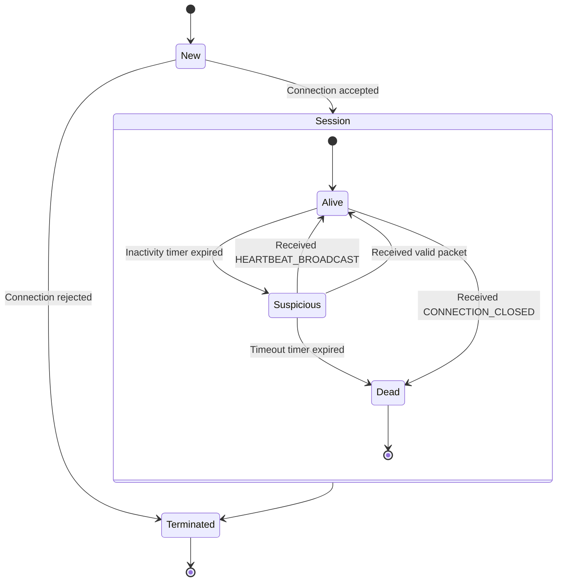
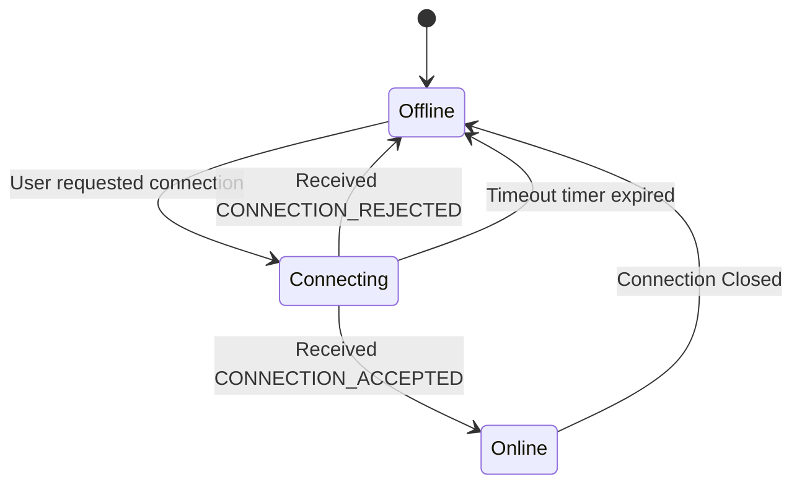
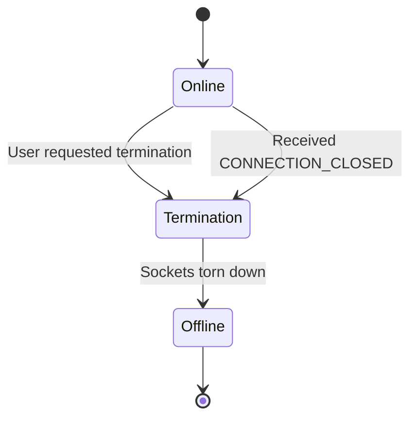
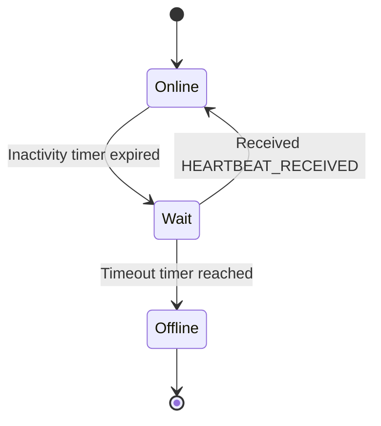
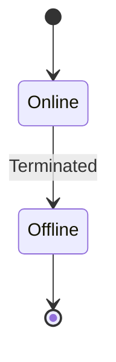

# RFC

## Summary

This document goes over the protocol used in the chatting app. Its goal is to add connection management and reliable user message communication on top of the standard UDP protocol.

## Conventions

This section will go over the conventions used in this document. It will give definitions and guidelines in order to keep the document consistent and understandable.

### Numbers

- **Binary**: Any value with the prefix `0b` is displayed as a binary value.
- **Hexadecimal**: Any value with the prefix `0x` is displayed as a hexadecimal value.
- **Decimal**: Any value without a prefix is displayed as a decimal value.
- **Numeration**: Any single digit decimal number written into text is displayed as their spelled out counter-part, succeeded by their decimal representation written within parentheses. 
- **Calculated Number**: Any value resulting from a calculation is displayed as a decimal, written as code.

### Binary Arrangement

The protocol uses the [big-endian](https://en.wikipedia.org/wiki/Endianness) format.

### Packet Format

This document displays packets using a custom format.

#### Rules

- Each field is displayed in order.
- Each field must have the starting bit offset above the box and to its most left.
- Each field must have the ending bit offset above the box and to its most right.
- Each offset must start from the start of the packet.
- Each field is displayed using a box defined with ASCII characters.
- The box with a starting or ending offset that exceeds a multiple of 128 creates and starts a new row under the previous row.
- Each field must display their name within the box.
- The box must be at least as long as the name, with a padding on the left and the right.
- Corners of the box must use the `+` symbol.
- Vertical sides of the box must use the `|` symbol.
- Horizontal sides of the box must use the `-` symbol.

#### Examples

The example will display the format of a packet with the following fields:
- Type: 8 bits
- Id: 32 bits
- Checksum: 32 bits
- Value: 64 bits
- Length: 16 bits
- Deep Checksum: 64 bits
- Signature: 40 bits
- Unused: 1 bit

```
 0    7 8 39 40      71
+------+----+----------+
| Type | Id | Checksum |
+------+----+----------+

 72  135 136  151 152         215 216     255
+-------+--------+---------------+-----------+
| Value | Length | Deep Checksum | Signature |
+-------+--------+---------------+-----------+

 256  257
+--------+
| Unused |
+--------+
```

### State Machines

This document uses state machines to display the overall flow of the application.

#### Transitions

A transition starting from and ending to the same state will not be displayed. If a self transition is present, it will only be defined within the state transition table.

Multiple transitions starting from a state and ending to a state will be displayed as long as the events or conditions are different. If multiple transitions have identical events and conditions, only one transition will be displayed. This transition will use a general label that describes the transitions it replaces. The original transitions will only be defined individually within the state transition table.

### State Transition Tables

This document uses transition tables to display how a state machine transitions between states.

#### Events

- **User Action**: Triggered by a manual action of the user.
- **Packet**: Triggered by the receipt of a valid packet. If a type is given, only valid packet of the given type can be used.
- **Timer**: Triggered by the expiration of a timer.
- **Internal**: Triggered by the execution of the previous state.

## Terminology

This section will go over the terminology used in this document. It will define what certain terms mean in the context of this document.

The key words “MUST”, “MUST NOT”, “SHOULD”, “SHOULD NOT” and “MAY” in this document are to be interpreted as described in [RFC 2119](https://www.rfc-editor.org/rfc/rfc2119).

- **Client**: Defines an instance of the client-side services
- **Server**: Defines an instance of the server-side services
- **User**: Defines an active connection between a client and a server
- **Packet**: Defines a standalone group of consecutive bits sent by the network.
- **Header**: Defines a shared group of consecutive bits sent by the network.
- **Upper [X]**: Defines the first instance of `[X]` starting from the most significant bit.
- **Lower [X]**: Defines the first instance of `[X]` ending at the least significant bit.
- **Tayste**: Defines a group of two (2) consecutive bits.
- **Nybble**: Defines a group of four (4) consecutive bits.
- **Request**: Defines a packet sent from a client to a server.
- **Response**: Defines a packet sent from a server to a client in regard to a prior request.
- **Push**: Defines a packet sent from a server to a client without a prior request.
- **Exchange**: Defines a packet sent from a server to a client, or from a client to a server.

## Overview

This protocol provides a reliable communication layer for a chat application running over the UDP protocol.

Due to raw UDP not guaranteeing delivery or connection state, this protocol introduces explicit handshakes, retransmissions for lost messages and periodic heartbeats.

The client is responsible for connecting to the server, sending sequenced messages, keeping track of a message history for packet recovery and maintaining liveness through heartbeats.

The server is responsible to identifying incoming connections, broadcasting messages between clients and managing client connection states.

## Headers

This section will go over the headers that can be used in different packets. Each header defines a packet format, a description for each of their fields and examples if appropriated.

### `PACKET_TYPE`

Header that defines the type of the packet. All packets **MUST** start with the header.

#### Format

```
 0      7
+--------+
|  Type  |
+--------+
```

#### Fields

| Name | Size             | Description                                         |
| ---- | ---------------- | --------------------------------------------------- |
| Type | 8 bits, unsigned | Magic number used to define the type of the packet. |

The field `Type` **MUST NOT** be `0x0`. Any value defined by a packet type **MUST** be supported. An unsupported type **MUST** be ignored.

### `USER_AUTHENTICATION`

Header that allows to identify a packet for a given user.

#### Format

```
 0               5
+-----------------+
| User Identifier |
+-----------------+
```

#### Fields

| Name            | Size             | Description                           |
| --------------- | ---------------- | ------------------------------------- |
| User Identifier | 6 bits, unsigned | Unique identifier for the local user. |

The field `User Identifier` **MUST** be unique across all connected users.

### `MISSING_MESSAGES`

Header that allows to notify of missing messages.

#### Format
```
 0                       7 8                71
+-------------------------+-------------------+
| Last Message Identifier | Received Messages |
+-------------------------+-------------------+
```

#### Fields

| Name                    | Size              | Description                                                                   |
| ----------------------- | ----------------- | ----------------------------------------------------------------------------- |
| Last Message Identifier | 8 bits, unsigned  | Identifier of the last received message. **MAY** be reused in other messages. |
| Received Messages       | 64 bits, unsigned | Flags defining if a previous message was received.                            |

The field `Received Messages` **MUST** be ordered starting from the least significant bit to the most significant bit. The offset from the least significant bit defines the offset from the field `Last Message Identifier`. If the field `Last Message Identifier` is greater than `64`, the field `Received Messages` **MUST** stop after `64` bits.  If the field `Last Message Identifier` is less than `64`, the field `Received Messages` **MUST** stop after `n` bits, where `n` is the value of `Last Message Identifier`.

#### Examples

Example of the header:

```
36							Last Message Identifier
FF FF FE FF FF FF DF C6		Received Messages
```

Example of how the missing messages with the identifiers `53`, `50`, `49`, `48`, `40` and `13` from the last message with the identifier `54` are requested:
```
Bytes: 36 FF FF FE FF FF FF DF C6
Bits: 0 0 1 1 0 1 1 0 1 1 1 1 1 1 1 1 1 1 1 1 1 1 1 1 1 1 1 1 1 1 1 0 1 1 1 1 1 1 1 1 1 1 1 1 1 1 1 1 1 1 1 1 1 1 1 1 1 1 0 1 1 1 1 1 1 1 0 0 0 1 1 0

Grouped Bits:
	- Last Message Identifier: 0 0 1 1 0 1 1 0
	- Received Messages: 1 1 1 1 1 1 1 1 1 1 1 1 1 1 1 1 1 1 1 1 1 1 1 0 1 1 1 1 1 1 1 1 1 1 1 1 1 1 1 1 1 1 1 1 1 1 1 1 1 1 0 1 1 1 1 1 1 1 0 0 0 1 1 0

Last Message Identifier: 54
Received Messages:
	1   1  1  1  1  1  1  1  1  1  1 1 1 1 1 1 1 1 1 1 1  1  1  0  1  1  1  1  1  1  1  1  1  1  1  1  1  1  1  1  1  1  1  1  1  1  1  1  1  1  0  1  1  1  1  1  1  1  0  0  0  1  1  0
	-10 -9 -8 -7 -6 -5 -4 -3 -2 -1 0 1 2 3 4 5 6 7 8 9 10 11 12 13 14 15 16 17 18 19 20 21 22 23 24 25 26 27 28 29 30 31 32 33 34 35 36 37 38 39 40 41 42 43 44 45 46 47 48 49 50 51 52 53
	|____________________________|                              |                                                                                |                       |  |  |        |
				  |                                             \________________________________________________________________________________|_______________________|__|__|________/
				  |                                                                                                       |
				ignored																									missing		
```

## Packets

This section will go over the packets used by the protocol. Each packet defines a packet format, a description for each of their fields and examples if appropriated.

### `CONNECTION_REQUEST`

Request to establish a connection.

#### Format

```
 0      7 8                11 12    15
+--------+-------------------+--------+
|  Type  | Client Identifier | Length |
+--------+-------------------+--------+

 16     143
+----------+
| Username |
+----------+
```

#### Fields

| Name              | Size               | Description                                                    |
| ----------------- | ------------------ | -------------------------------------------------------------- |
| Type              | 8 bits, unsigned   | Field defined in the header `PACKET_TYPE`. **MUST** be `0x01`. |
| Client Identifier | 4 bits, unsigned   | Client identifier for the local client instance.               |
| Length            | 4 bits, unsigned   | Length of the username in bytes. **MUST** be offset by 1.      |
| Username          | 128 bits, unsigned | Characters of the username. **MUST** be ASCII characters.      |

The field `Client Identifier` **MUST** be randomly generated.

The field `Length` is offset by one (1). For a username of one (1) character, the length **MUST** be `0x0`. For a username of 16 characters, the length **MUST** be `0xF`. This allows the
username to be a maximum of 16 characters, while still fitting inside a nybble.

The field `Username` **MUST** be of length defined by the field `Length`. The protocol **MUST NOT** assume that the field takes the full possible length. For a username of three (3) characters, the total size of the field `Username` will be `24` bits. Usernames with no character or a length of zero (0) or less **MUST NOT** be allowed.

Each character of the field `Username` **MUST** is one (1) byte in length.

#### Examples

Example of a packet:

```
01					Type
C5					Client Identifier + Length
50 6C 51 79 65 72	Username
```

Example of how the username `Player` is found:

```
Bytes: 01 C5 50 6C 51 79 65 72
Nybbles: 0 1 C 5 5 0 6 C 5 1 7 9 6 5 7 2
Grouped Nybbles:
	- Type: 0 1
	- Client Identifier: C
	- Length: 5
	- Username: 5 0 6 c 6 1 7 9 6 5 7 2

Type: 1
Client Identifier: 12
Length: 5
Username:
	5 0 6 c 6 1 7 9 6 5 7 2
	|/  |/  |/  |/  |/  |/
	50  6c  61  79  65  72
	P   l   a   y   e   r
```

### `CONNECTION_ACCEPTED`

Response to accept the connection request.

#### Format

```
 0      7 8              13
+--------+-----------------+
|  Type  | User Identifier |
+--------+-----------------+
```

#### Fields

| Name            | Size             | Description                                                    |
| --------------- | ---------------- | -------------------------------------------------------------- |
| Type            | 8 bits, unsigned | Field defined in the header `PACKET_TYPE`. **MUST** be `0x02`. |
| User Identifier | 6 bits, unsigned | Field defined in the header `USER_AUTHENTICATION`.             |

### `CONNECTION_REJECTED`

Response to reject the connection request.

#### Format

```
 0      7 
+--------+
|  Type  |
+--------+
```

#### Fields

| Name | Size             | Description                                                    |
| ---- | ---------------- | -------------------------------------------------------------- |
| Type | 8 bits, unsigned | Field defined in the header `PACKET_TYPE`. **MUST** be `0x03`. |

### `CONNECTION_CLOSED`

Exchange to notify that the connection is closed.

#### Format

```
 0      7 8              13
+--------+-----------------+
|  Type  | User Identifier |
+--------+-----------------+
```

#### Fields

| Name            | Size             | Description                                                    |
| --------------- | ---------------- | -------------------------------------------------------------- |
| Type            | 8 bits, unsigned | Field defined in the header `PACKET_TYPE`. **MUST** be `0x02`. |
| User Identifier | 6 bits, unsigned | Field defined in the header `USER_AUTHENTICATION`.             |

The field `User Identifier` **MUST** be ignored when this packet is sent by the server.

### `MESSAGE_BROADCAST`

> [!IMPORTANT]
> Redesign

Exchange to broadcast a message.

#### Format

```
 0      7 8              13 14                     21 22               85 86                93 94           103
+--------+-----------------+-------------------------+-------------------+--------------------+----------------+
|  Type  | User Identifier | Last Message Identifier | Received Messages | Message Identifier | Message Length |
+--------+-----------------+-------------------------+-------------------+--------------------+----------------+

 104  8103
+---------+
| Message |
+---------+
```

#### Fields

| Name                    | Size                | Description                                                     |
| ----------------------- | ------------------- | --------------------------------------------------------------- |
| Type                    | 8 bits, unsigned    | Field defined in the header `PACKET_TYPE`. **MUST** be `0x10`.  |
| User Identifier         | 6 bits, unsigned    | Field defined in the header `USER_AUTHENTICATION`.              |
| Last Message Identifier | 8 bits, unsigned    | Field defined in the header `MISSING_MESSAGES`.                 |
| Received Messages       | 64 bits, unsigned   | Field defined in the header `MISSING_MESSAGES`.                 |
| Message Identifier      | 8 bits, unsigned    | Identifier of the message. **MAY** be reused in other messages. |
| Message Length          | 10 bits, unsigned   | Length of the message in bytes.                                 |
| Message                 | 8000 bits, unsigned | Characters of the message. **MUST** be ASCII characters.        |

The field `Message Length` **MUST NOT** be more than `1000`. The field `Message Length` **MUST NOT** be equal to zero (0). Any message with a length of zero (0) **MUST** be ignored.

The field `Message` **MUST** be of length defined by the field `Message Length`. The server **MUST** discard any message that exceeds `1000` characters. The protocol **MUST NOT** assume that the field takes the full possible length. For a message of three (3) characters, the total size of the field `Message` will be `24` bits.

#### Examples

Example of a packet:

```
10				   					Type
94									User Identifier + Upper tayste of Message Identifier
00                					Lower 6 bits of Message Identifier + Upper tayste of Message Length
0B				   					Lower byte of Message Length
48 65 6C 6C 6F 20 57 6F 72 6C 64 	Message
```

Example of how the message `Hello World` is found:
```
Bytes: 10 94 00 0B 48 65 6C 6C 6F 20 57 6F 72 6C 64
Taystes: 00 01 00 00 10 01 01 00 00 00 00 00 00 00 10 11 01 00 10 00 01 10 01 01 01 10 11 00 01 10 11 00 01 10 11 11 00 10 00 00 01 01 01 11 01 10 11 11 01 11 00 10 01 10 11 00 01 10 01 00
Bits: 0 0 0 1 0 0 0 0 1 0 0 1 0 1 0 0 0 0 0 0 0 0 0 0 0 0 0 0 1 0 1 1 0 1 0 0 1 0 0 0 0 1 1 0 0 1 0 1 0 1 1 0 1 1 0 0 0 1 1 0 1 1 0 0 0 1 1 0 1 1 1 1 0 0 1 0 0 0 0 0 0 1 0 1 0 1 1 1 0 1 1 0 1 1 1 1 0 1 1 1 0 0 1 0 0 1 1 0 1 1 0 0 0 1 1 0 0 1 0 0

Grouped Bits:
	- Type: 0 0 0 1 0 0 0 0
	- User Identifier: 1 0 0 1 0 1
	- Message Identifier: 0 0 0 0 0 0 0 0
	- Message Length: 0 0 0 0 0 0 1 0 1 1
	- Message: 0 1 0 0 1 0 0 0 0 1 1 0 0 1 0 1 0 1 1 0 1 1 0 0 0 1 1 0 1 1 0 0 0 1 1 0 1 1 1 1 0 0 1 0 0 0 0 0 0 1 0 1 0 1 1 1 0 1 1 0 1 1 1 1 0 1 1 1 0 0 1 0 0 1 1 0 1 1 0 0 0 1 1 0 0 1 0 0

Hexadecimal Grouped Bits:
	- Type: 10
	- User Identifier: 25
	- Message Identifier: 00
	- Message Length: 0B
	- Message: 48 65 6C 6C 6F 20 57 6F 72 6C 64

Type: 16
User Identifier: 37
Message Identifier: 0
Message Length: 11
Message:
	48 65 6C 6C 6F 20    57 6F 72 6C 64
	H  e  l  l  o  Space W  o  r  l  d
```

### `MESSAGE_REQUEST`

Exchange to request a message.

#### Format

```
 0      7 8              13 14                     21 22               85
+--------+-----------------+-------------------------+-------------------+
|  Type  | User Identifier | Last Message Identifier | Received Messages |
+--------+-----------------+-------------------------+-------------------+
```

#### Fields

| Name                    | Size              | Description                                                    |
| ----------------------- | ----------------- | -------------------------------------------------------------- |
| Type                    | 8 bits, unsigned  | Field defined in the header `PACKET_TYPE`. **MUST** be `0x11`. |
| User Identifier         | 6 bits, unsigned  | Field defined in the header `USER_AUTHENTICATION`.             |
| Last Message Identifier | 8 bits, unsigned  | Field defined in the header `MISSING_MESSAGES`.                |
| Received Messages       | 64 bits, unsigned | Field defined in the header `MISSING_MESSAGES`.                |

The field `User Identifier` **MUST** be ignored when this packet is sent by the server.

### `HEARTBEAT_BROADCAST`

Request to notify of the health status of the client.

#### Format

```
 0      7 8              13 14                     21 22               85
+--------+-----------------+-------------------------+-------------------+
|  Type  | User Identifier | Last Message Identifier | Received Messages |
+--------+-----------------+-------------------------+-------------------+
```

#### Fields

| Name                    | Size              | Description                                                    |
| ----------------------- | ----------------- | -------------------------------------------------------------- |
| Type                    | 8 bits, unsigned  | Field defined in the header `PACKET_TYPE`. **MUST** be `0x11`. |
| User Identifier         | 6 bits, unsigned  | Field defined in the header `USER_AUTHENTICATION`.             |
| Last Message Identifier | 8 bits, unsigned  | Field defined in the header `MISSING_MESSAGES`.                |
| Received Messages       | 64 bits, unsigned | Field defined in the header `MISSING_MESSAGES`.                |

### `HEARTBEAT_RECEIVED`

Response to notify that the health status was received.

#### Format

```
 0      7 8                      15 16               79
+--------+-------------------------+-------------------+
|  Type  | Last Message Identifier | Received Messages |
+--------+-------------------------+-------------------+
```

#### Fields

| Name                    | Size              | Description                                                    |
| ----------------------- | ----------------- | -------------------------------------------------------------- |
| Type                    | 8 bits, unsigned  | Field defined in the header `PACKET_TYPE`. **MUST** be `0x21`. |
| Last Message Identifier | 8 bits, unsigned  | Field defined in the header `MISSING_MESSAGES`.                |
| Received Messages       | 64 bits, unsigned | Field defined in the header `MISSING_MESSAGES`.                |

### `HEARTBEAT_REQUEST`

Push to request a health status notification.

#### Format

```
 0      7 8                      15 16               79
+--------+-------------------------+-------------------+
|  Type  | Last Message Identifier | Received Messages |
+--------+-------------------------+-------------------+
```

#### Fields

| Name                    | Size              | Description                                                    |
| ----------------------- | ----------------- | -------------------------------------------------------------- |
| Type                    | 8 bits, unsigned  | Field defined in the header `PACKET_TYPE`. **MUST** be `0x22`. |
| Last Message Identifier | 8 bits, unsigned  | Field defined in the header `MISSING_MESSAGES`.                |
| Received Messages       | 64 bits, unsigned | Field defined in the header `MISSING_MESSAGES`.                |

## State Machines

### Server

The server maintains a state machine for each individual client connection, tracked via the client's IP address and port.

#### Diagram



#### Transition Table

| Current State | Event    | Condition                                  | Action                                      | Next State |
| ------------- | -------- | ------------------------------------------ | ------------------------------------------- | ---------- |
| New           | Packet   | Received accepted `CONNECTION_REQUEST`     | Send `CONNECTION_ACCEPTED`, register client | Alive      |
| New           | Packet   | Received rejected `CONNECTION_REQUEST`     | Send `CONNECTION_REJECTED`                  | Terminated |
| Alive         | Timer    | `CLIENT_INACTIVITY_WARNING` timer expired  | Send `HEARTBEAT_REQUEST`                    | Suspicious |
| Alive         | Packet   | Received `CONNECTION_CLOSED`               | Unregister client                           | Dead       |
| Suspicious    | Timer    | `HEARTBEAT_REQUEST_INTERVAL` timer expired | Send `HEARTBEAT_REQUEST`                    | Suspicious |
| Suspicious    | Packet   | Received `HEARTBEAT_BROADCAST`             | Send `HEARTBEAT_RECEIVED`                   | Alive      |
| Suspicious    | Packet   | Received any valid packet                  | Pass received package to next state         | Alive      |
| Suspicious    | Timer    | `CLIENT_INACTIVITY_TIMEOUT` timer expired  | Unregister client                           | Dead       |
| Dead          | Internal | Action Executed                            | Clean client resources                      | Terminated |

### Client

#### Connection

##### Diagram



##### Transition Table

| Current State | Event       | Condition                                  | Action                       | Next State |
| ------------- | ----------- | ------------------------------------------ | ---------------------------- | ---------- |
| Offline       | User Action | User requested connection                  | Send `CONNECTION_REQUEST`    | Connecting |
| Connecting    | Packet      | Received `CONNECTION_REJECTED`             | Notify user of rejection     | Offline    |
| Connecting    | Packet      | Received `CONNECTION_ACCEPTED`             | Notify user of success       | Online     |
| Connecting    | Timer       | `SERVER_CONNECTION_INTERVAL` timer expired | Send `CONNECTION_REQUEST`    | Connecting |
| Connecting    | Timer       | `SERVER_CONNECTION_TIMEOUT` timer expired  | Notify user of failure       | Offline    |
| Online        | Packet      | Received `CONNECTION_CLOSED`               | Notify user of disconnection | Offline    |
| Online        | User Action | User requested disconnection               | Send `CONNECTION_CLOSED`     | Offline    |

#### Disconnection

##### Diagram



##### Transition Table

| Current State | Event       | Condition                    | Action                     | Next State  |
| ------------- | ----------- | ---------------------------- | -------------------------- | ----------- |
| Online        | User Action | User requested termination   | Send `CONNECTION_CLOSED`   | Termination |
| Online        | Packet      | Received `CONNECTION_CLOSED` | Notify user of termination | Termination |
| Termination   | Internal    | Action executed              | Tear down local sockets    | Offline     |
	
#### Heartbeat

##### Diagram



##### Transition Table

| Current State | Event  | Condition                                         | Action                     | Next State |
| ------------- | ------ | ------------------------------------------------- | -------------------------- | ---------- |
| Online        | Timer  | `INACTIVITY_WARNING` timer expired                | Send `HEARTBEAT_BROADCAST` | Wait       |
| Online        | Packet | Received `HEARTBEAT_REQUEST`                      | Send `HEARTBEAT_BROADCAST` | Online     |
| Wait          | Packet | Received `HEARTBEAT_RECEIVED`                     | None                       | Online     |
| Wait          | Packet | Received `HEARTBEAT_REQUEST`                      | Send `HEARTBEAT_BROADCAST` | Online     |
| Wait          | Timer  | `HEARTBEAT_INTERVAL` timer expired                | Send `HEARTBEAT_BROADCAST` | Wait       |
| Wait          | Timer  | `SERVER_INACTIVITY_TIMEOUT` seconds timer expired | Send `CONNECTION_CLOSED`   | Offline    |

#### Data Transfer

##### Diagram



##### Transition Table

| Current State | Event       | Condition                    | Action                             | Next State |
| ------------- | ----------- | ---------------------------- | ---------------------------------- | ---------- |
| Online        | User Action | User submitted a message     | Send and cache `MESSAGE_BROADCAST` | Online     |
| Online        | Packet      | Received `MESSAGE_BROADCAST` | Display message to user            | Online     |
| Online        | Packet      | Received `MESSAGE_REQUEST`   | Send cached `MESSAGE_BROADCAST`    | Online     |
| Online        | Internal    | Action executed              | Tear down local sockets            | Offline    |

## Procédures

établissement, terminaison, heartbeat, numérotation, NACK, retransmission.

## Constants

This section will go over the different constants defined by the protocol. A server or a client **MAY** change the values of any constant.

| Name                         | Default Value    | Description                                                              |
| ---------------------------- | ---------------- | ------------------------------------------------------------------------ |
| `HEARTBEAT_INTERVAL`         | 200 milliseconds | Interval on which the client **MUST** send a heartbeat                   |
| `HEARTBEAT_REQUEST_INTERVAL` | 200 milliseconds | Interval on which the server **MUST** send a heartbeat request           |
| `INACTIVITY_WARNING`         | 1 second         | Time needed before a client **MUST** start sending heartbeats            |
| `CLIENT_INACTIVITY_WARNING`  | 1.5 seconds      | Time needed before a server **MUST** warn a client about its inactivity  |
| `CLIENT_INACTIVITY_TIMEOUT`  | 3 seconds        | Time needed before a server **MUST** disconnect a client from inactivity |
| `SERVER_INACTIVITY_TIMEOUT`  | 3 seconds        | Time needed before a client **MUST** disconnect from unreachable server  |
| `SERVER_CONNECTION_INTERVAL` | 1 second         | Interval on which the client **MUST** retry to send a connection request |
| `SERVER_CONNECTION_TIMEOUT`  | 10 seconds       | Time needed before a client **MUST** declare a server as unreachable     |

A server or a client **MUST NOT** assume that the constant values are the default values defined by the protocol.

## Error management

This section will go over how the server and the client must manage erroneous packets.

Unless a server or a client is mentioned, any rule given **MUST** be applied to the server and the client.

### Malformed Packets

When a malformed packet is received, the packet **MUST** be discarded.

### Unknown Packet Sources

When the server receives a `CONNECTION_REQUEST` from a unknown source, the server **MUST** follow the connection procedure.

When another type of packet is received from a unknown source, the packet **MUST** be discarded. The packet type **MAY** be defined, but **MUST NOT** be handled within the context of the current state.

## Exemples d’échanges

au moins trois diagrammes de séquence, dont un avec perte de paquets.