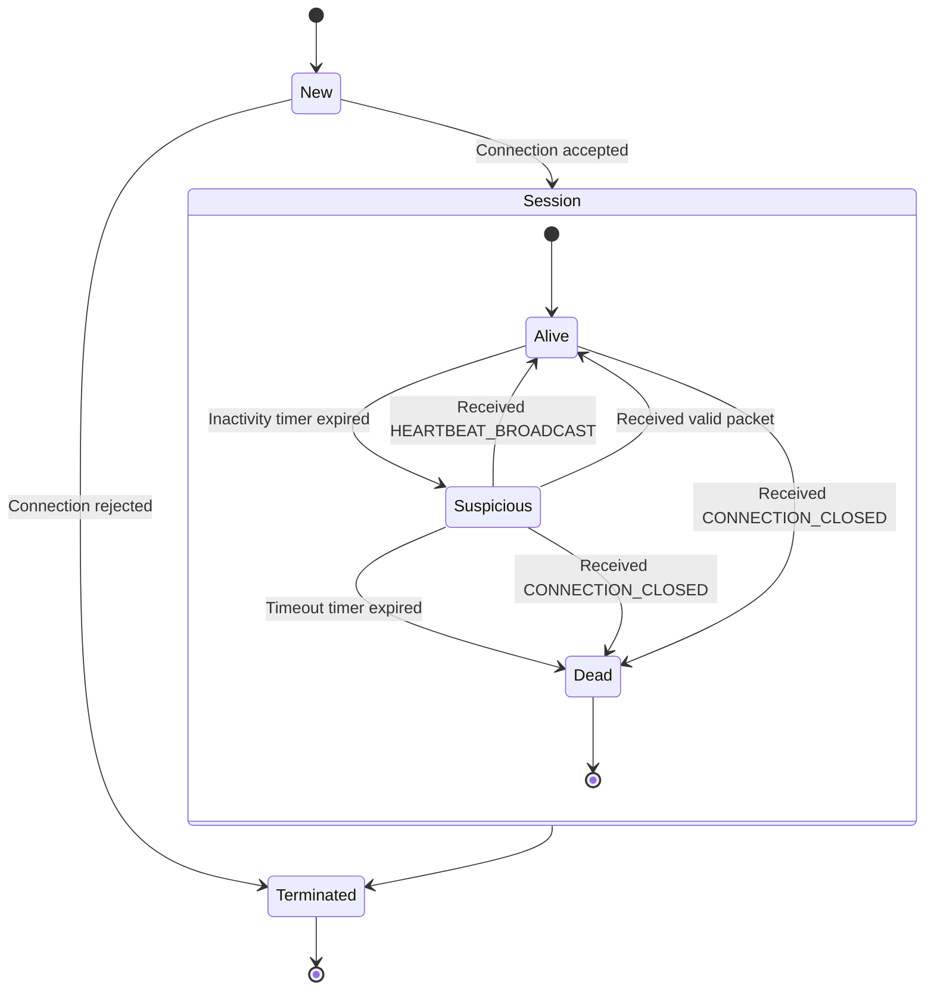
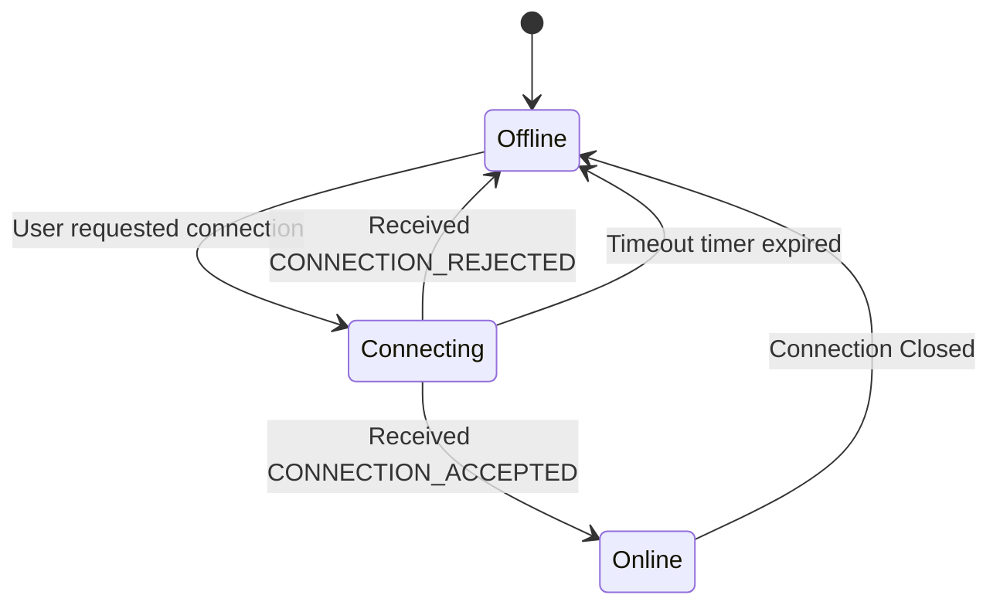
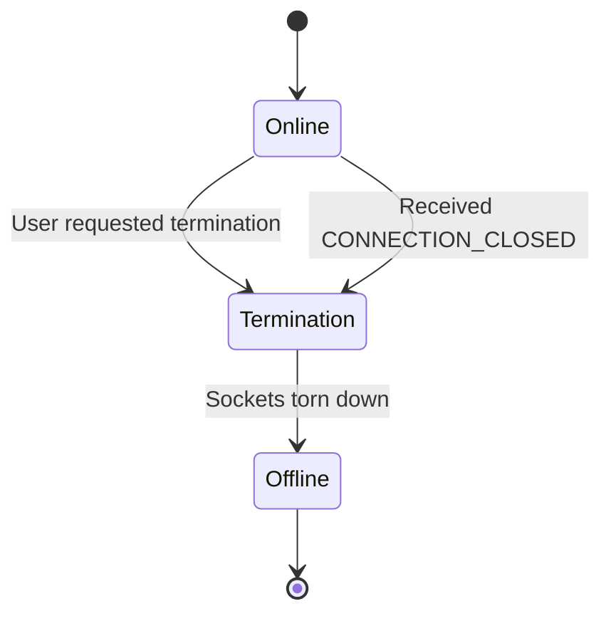
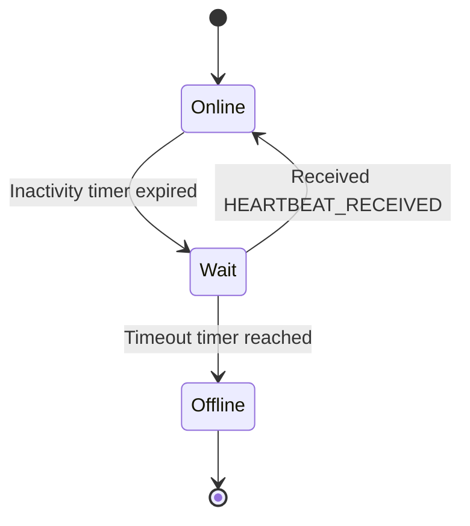
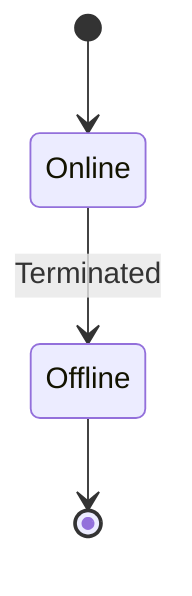
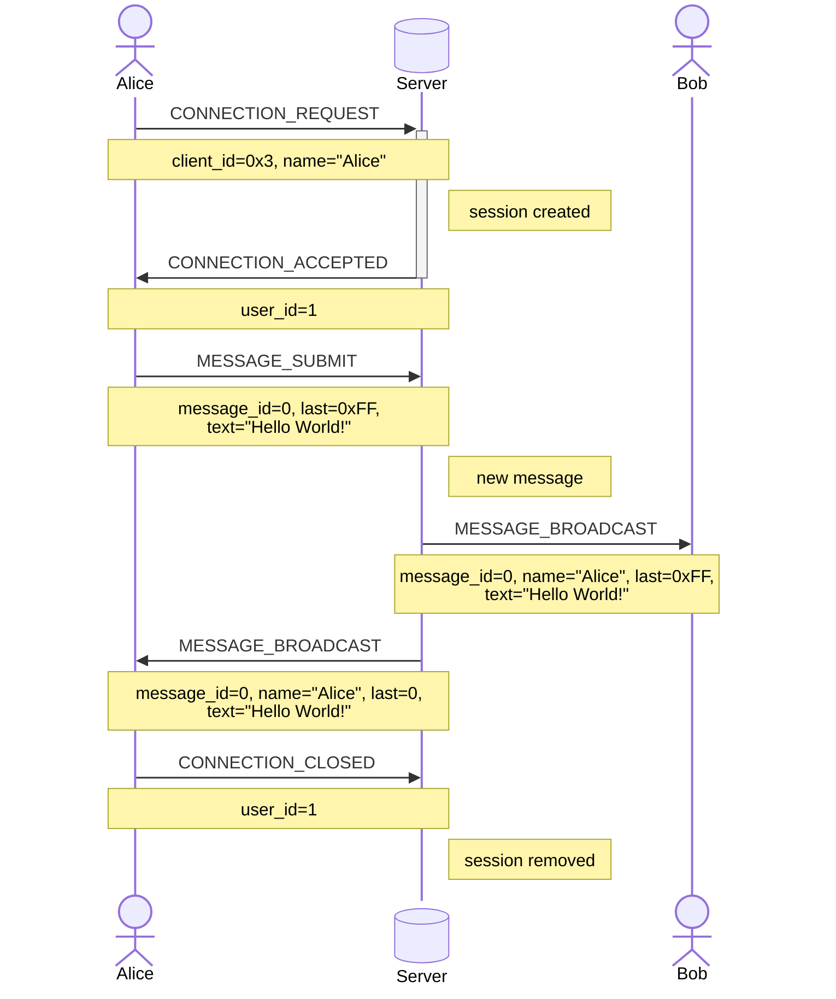
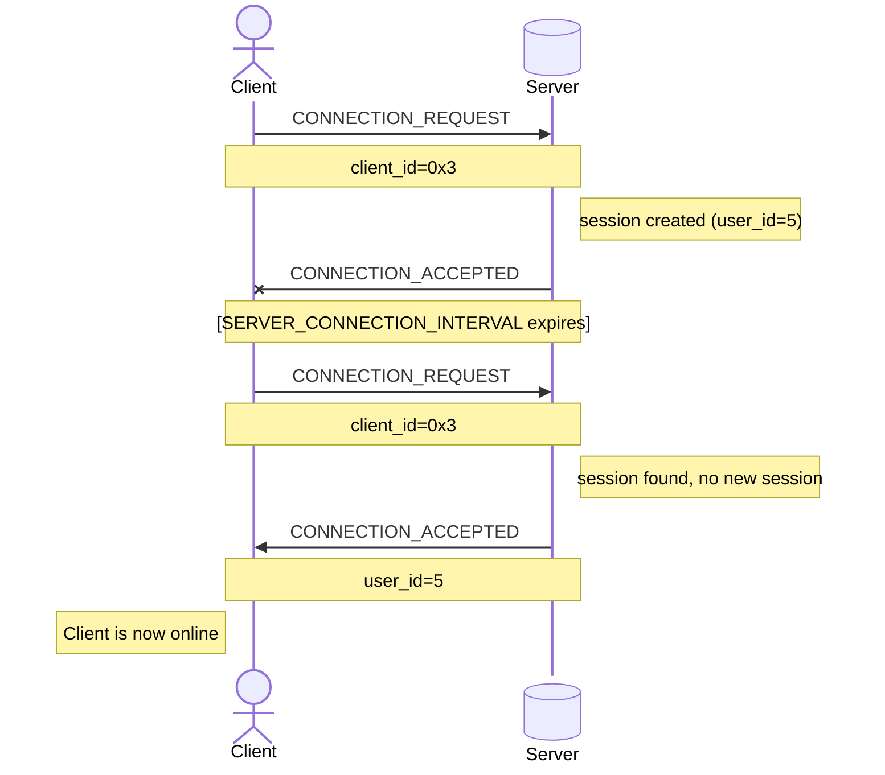
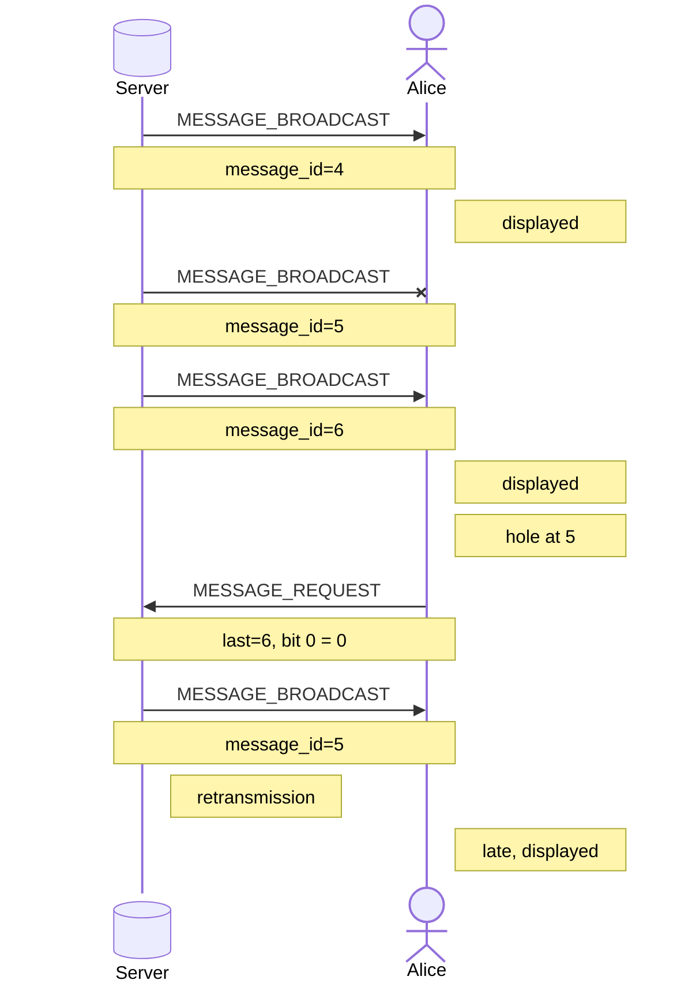
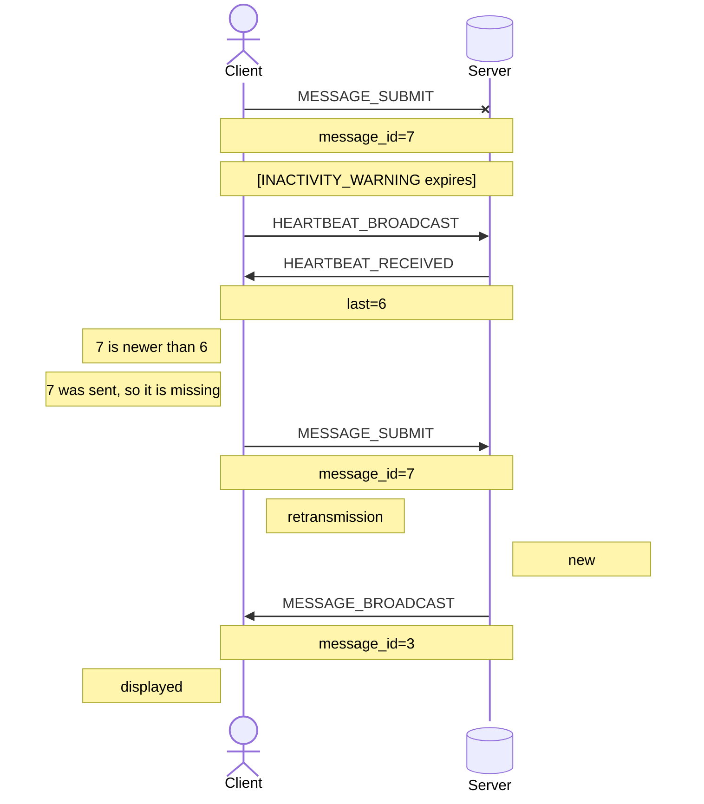
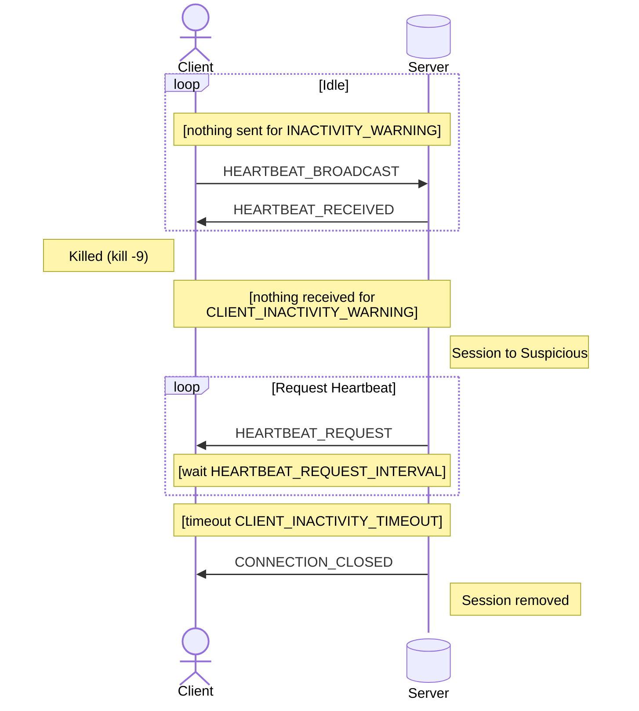

# RFC

## Summary

This document goes over the protocol used in the chatting app. Its goal is to add connection management and reliable user message communication on top of the standard UDP protocol.

## Conventions

This section will go over the conventions used in this document. It will give definitions and guidelines in order to keep the document consistent and understandable.

### Numbers

- **Binary**: Any value with the prefix `0b` is displayed as a binary value.
- **Hexadecimal**: Any value with the prefix `0x` is displayed as a hexadecimal value.
- **Decimal**: Any value without a prefix is displayed as a decimal value.
- **Numeration**: Any single digit decimal number written into text is displayed as their spelled out counter-part, succeeded by their decimal representation written within parentheses. 
- **Calculated Number**: Any value resulting from a calculation is displayed as a decimal, written as code.

### Binary Arrangement

The protocol uses the [big-endian](https://en.wikipedia.org/wiki/Endianness) format.

### Packet Format

This document displays packets using a custom format.

#### Rules

- Each field is displayed in order.
- Each field must have the starting bit offset above the box and to its most left.
- Each field must have the ending bit offset above the box and to its most right.
- Each offset must start from the start of the packet.
- Each field is displayed using a box defined with ASCII characters.
- The box with a starting or ending offset that exceeds a multiple of 128 creates and starts a new row under the previous row.
- Each field must display their name within the box.
- The box must be at least as long as the name, with a padding on the left and the right.
- Corners of the box must use the `+` symbol.
- Vertical sides of the box must use the `|` symbol.
- Horizontal sides of the box must use the `-` symbol.

#### Examples

The example will display the format of a packet with the following fields:
- Type: 8 bits
- Id: 32 bits
- Checksum: 32 bits
- Value: 64 bits
- Length: 16 bits
- Deep Checksum: 64 bits
- Signature: 40 bits
- Unused: 1 bit

```
 0    7 8 39 40      71
+------+----+----------+
| Type | Id | Checksum |
+------+----+----------+

 72  135 136  151 152         215 216     255
+-------+--------+---------------+-----------+
| Value | Length | Deep Checksum | Signature |
+-------+--------+---------------+-----------+

 256  257
+--------+
| Unused |
+--------+
```

### State Machines

This document uses state machines to display the overall flow of the application.

#### Transitions

A transition starting from and ending to the same state will not be displayed. If a self transition is present, it will only be defined within the state transition table.

Multiple transitions starting from a state and ending to a state will be displayed as long as the events or conditions are different. If multiple transitions have identical events and conditions, only one transition will be displayed. This transition will use a general label that describes the transitions it replaces. The original transitions will only be defined individually within the state transition table.

### State Transition Tables

This document uses transition tables to display how a state machine transitions between states.

#### Events

- **User Action**: Triggered by a manual action of the user.
- **Packet**: Triggered by the receipt of a valid packet. If a type is given, only valid packet of the given type can be used.
- **Timer**: Triggered by the expiration of a timer.
- **Internal**: Triggered by the execution of the previous state.

## Terminology

This section will go over the terminology used in this document. It will define what certain terms mean in the context of this document.

The key words “MUST”, “MUST NOT”, “SHOULD”, “SHOULD NOT” and “MAY” in this document are to be interpreted as described in [RFC 2119](https://www.rfc-editor.org/rfc/rfc2119).

- **Client**: Defines an instance of the client-side services
- **Server**: Defines an instance of the server-side services
- **User**: Defines an active connection between a client and a server
- **Packet**: Defines a standalone group of consecutive bits sent by the network.
- **Header**: Defines a shared group of consecutive bits sent by the network.
- **Upper [X]**: Defines the first instance of `[X]` starting from the most significant bit.
- **Lower [X]**: Defines the first instance of `[X]` ending at the least significant bit.
- **Tayste**: Defines a group of two (2) consecutive bits.
- **Nybble**: Defines a group of four (4) consecutive bits.
- **Request**: Defines a packet sent from a client to a server.
- **Response**: Defines a packet sent from a server to a client in regard to a prior request.
- **Push**: Defines a packet sent from a server to a client without a prior request.
- **Exchange**: Defines a packet sent from a server to a client, or from a client to a server.

## Overview

This protocol provides a reliable communication layer for a chat application running over the UDP protocol.

Due to raw UDP not guaranteeing delivery or connection state, this protocol introduces explicit handshakes, retransmissions for lost messages and periodic heartbeats.

The client is responsible for connecting to the server, sending sequenced messages, keeping track of a message history for packet recovery and maintaining liveness through heartbeats.

The server is responsible to identifying incoming connections, broadcasting messages between clients and managing client connection states.

## Headers

This section will go over the headers that can be used in different packets. Each header defines a packet format, a description for each of their fields and examples if appropriated.

### `PACKET_TYPE`

Header that defines the type of the packet. All packets **MUST** start with the header.

#### Format

```
 0      7
+--------+
|  Type  |
+--------+
```

#### Fields

| Name | Size             | Description                                         |
| ---- | ---------------- | --------------------------------------------------- |
| Type | 8 bits, unsigned | Magic number used to define the type of the packet. |

The field `Type` **MUST NOT** be `0x0`. Any value defined by a packet type **MUST** be supported. An unsupported type **MUST** be ignored.

### `USER_AUTHENTICATION`

Header that allows to identify a packet for a given user.

#### Format

```
 0               5
+-----------------+
| User Identifier |
+-----------------+
```

#### Fields

| Name            | Size             | Description                           |
| --------------- | ---------------- | ------------------------------------- |
| User Identifier | 6 bits, unsigned | Unique identifier for the local user. |

The field `User Identifier` **MUST** be unique across all connected users. The field `User Identifier` **MUST NOT** be `0b000000`.

### `USERNAME_CONTENT`

Header that allows to communicate the user name of a given user.

#### Format

```
 0               3
+-----------------+
| Username Length |
+-----------------+

 4      131
+----------+
| Username |
+----------+
```

#### Fields

| Name            | Size               | Description                                               |
| --------------- | ------------------ | --------------------------------------------------------- |
| Username Length | 4 bits, unsigned   | Length of the username in bytes. **MUST** be offset by 1. |
| Username        | 128 bits, unsigned | Characters of the username. **MUST** be ASCII characters. |

The field `Username Length` is offset by one (1). For a username of one (1) character, the length **MUST** be `0x0`. For a username of 16 characters, the length **MUST** be `0xF`. This allows the
username to be a maximum of 16 characters, while still fitting inside a nybble.

The field `Username` **MUST** be of length defined by the field `Username Length`. The protocol **MUST NOT** assume that the field takes the full possible length. For a username of three (3) characters, the total size of the field `Username` will be `24` bits. Usernames with no character or a length of zero (0) or less **MUST NOT** be allowed.

Each character of the field `Username` **MUST** is one (1) byte in length.


### `MESSAGE_CONTENT`

Header that allows to communicate a message.

#### Format

```
 0              9
+----------------+
| Message Length |
+----------------+

 10   7929
+---------+
| Message |
+---------+
```

#### Fields

| Name           | Size                | Description                                              |
| -------------- | ------------------- | -------------------------------------------------------- |
| Message Length | 10 bits, unsigned   | Length of the message in bytes.                          |
| Message        | 7920 bits, unsigned | Characters of the message. **MUST** be ASCII characters. |

The field `Message Length` **MUST NOT** be more than `990`. The field `Message Length` **MUST NOT** be equal to zero (0). Any message with a length of zero (0) **MUST** be ignored.

The field `Message` **MUST** be of length defined by the field `Message Length`. The server **MUST** discard any message that exceeds `990` characters. The protocol **MUST NOT** assume that the field takes the full possible length. For a message of three (3) characters, the total size of the field `Message` will be `24` bits.

Each character of the field `Message` **MUST** is one (1) byte in length.

### `MISSING_MESSAGES`

Header that allows to notify of missing messages.

#### Format
```
 0                       7 8                71
+-------------------------+-------------------+
| Last Message Identifier | Received Messages |
+-------------------------+-------------------+
```

#### Fields

| Name                    | Size              | Description                                                                   |
| ----------------------- | ----------------- | ----------------------------------------------------------------------------- |
| Last Message Identifier | 8 bits, unsigned  | Identifier of the last received message. **MAY** be reused in other messages. |
| Received Messages       | 64 bits, unsigned | Flags defining if a previous message was received.                            |

The field `Received Messages` **MUST** be ordered starting from the least significant bit to the most significant bit. The bit `n` is `0b1` if the message with the identifier `Last Message Identifier - 1 - n` was received, and `0b0` otherwise, using modular arithmetic on `256`. A bit that refers to a message older than the first message of the stream **MUST** be `0b1`. The `Last Message Identifier` itself is always considered received and is not part of the field.

#### Examples

Example of the header:

```
36							Last Message Identifier
FF FF FE FF FF FF DF C6		Received Messages
```

Example of how the missing messages with the identifiers `53`, `50`, `49`, `48`, `40` and `13` from the last message with the identifier `54` are requested:
```
Bytes: 36 FF FF FE FF FF FF DF C6
Bits: 0 0 1 1 0 1 1 0 1 1 1 1 1 1 1 1 1 1 1 1 1 1 1 1 1 1 1 1 1 1 1 0 1 1 1 1 1 1 1 1 1 1 1 1 1 1 1 1 1 1 1 1 1 1 1 1 1 1 0 1 1 1 1 1 1 1 0 0 0 1 1 0

Grouped Bits:
	- Last Message Identifier: 0 0 1 1 0 1 1 0
	- Received Messages: 1 1 1 1 1 1 1 1 1 1 1 1 1 1 1 1 1 1 1 1 1 1 1 0 1 1 1 1 1 1 1 1 1 1 1 1 1 1 1 1 1 1 1 1 1 1 1 1 1 1 0 1 1 1 1 1 1 1 0 0 0 1 1 0

Last Message Identifier: 54
Received Messages:
	1   1  1  1  1  1  1  1  1  1  1 1 1 1 1 1 1 1 1 1 1  1  1  0  1  1  1  1  1  1  1  1  1  1  1  1  1  1  1  1  1  1  1  1  1  1  1  1  1  1  0  1  1  1  1  1  1  1  0  0  0  1  1  0
	-10 -9 -8 -7 -6 -5 -4 -3 -2 -1 0 1 2 3 4 5 6 7 8 9 10 11 12 13 14 15 16 17 18 19 20 21 22 23 24 25 26 27 28 29 30 31 32 33 34 35 36 37 38 39 40 41 42 43 44 45 46 47 48 49 50 51 52 53
	|____________________________|                              |                                                                                |                       |  |  |        |
				  |                                             \________________________________________________________________________________|_______________________|__|__|________/
				  |                                                                                                       |
				ignored																									missing		
```

## Packets

This section will go over the packets used by the protocol. Each packet defines a packet format, a description for each of their fields and examples if appropriated.

### `CONNECTION_REQUEST`

Request to establish a connection.

#### Format

```
 0      7 8                11 12             15
+--------+-------------------+-----------------+
|  Type  | Client Identifier | Username Length |
+--------+-------------------+-----------------+

 16     143
+----------+
| Username |
+----------+
```

#### Fields

| Name              | Size               | Description                                                    |
| ----------------- | ------------------ | -------------------------------------------------------------- |
| Type              | 8 bits, unsigned   | Field defined in the header `PACKET_TYPE`. **MUST** be `0x01`. |
| Client Identifier | 4 bits, unsigned   | Client identifier for the local client instance.               |
| Username Length   | 4 bits, unsigned   | Field defined in the header `USERNAME_CONTENT`.                |
| Username          | 128 bits, unsigned | Field defined in the header `USERNAME_CONTENT`.                |

The field `Client Identifier` **MUST** be randomly generated.

#### Examples

Example of a packet:

```
01					Type
C5					Client Identifier + Length
50 6C 61 79 65 72	Username
```

Example of how the username `Player` is found:

```
Bytes: 01 C5 50 6C 61 79 65 72
Nybbles: 0 1 C 5 5 0 6 C 6 1 7 9 6 5 7 2
Grouped Nybbles:
	- Type: 0 1
	- Client Identifier: C
	- Length: 5
	- Username: 5 0 6 C 6 1 7 9 6 5 7 2

Type: 1
Client Identifier: 12
Length: 5
Username:
	5 0 6 C 6 1 7 9 6 5 7 2
	|/  |/  |/  |/  |/  |/
	50  6c  61  79  65  72
	P   l   a   y   e   r
```

### `CONNECTION_ACCEPTED`

Response to accept the connection request.

#### Format

```
 0      7 8              13
+--------+-----------------+
|  Type  | User Identifier |
+--------+-----------------+
```

#### Fields

| Name            | Size             | Description                                                    |
| --------------- | ---------------- | -------------------------------------------------------------- |
| Type            | 8 bits, unsigned | Field defined in the header `PACKET_TYPE`. **MUST** be `0x02`. |
| User Identifier | 6 bits, unsigned | Field defined in the header `USER_AUTHENTICATION`.             |

### `CONNECTION_REJECTED`

Response to reject the connection request.

#### Format

```
 0      7 
+--------+
|  Type  |
+--------+
```

#### Fields

| Name | Size             | Description                                                    |
| ---- | ---------------- | -------------------------------------------------------------- |
| Type | 8 bits, unsigned | Field defined in the header `PACKET_TYPE`. **MUST** be `0x03`. |

### `CONNECTION_CLOSED`

Exchange to notify that the connection is closed.

#### Format

```
 0      7 8              13
+--------+-----------------+
|  Type  | User Identifier |
+--------+-----------------+
```

#### Fields

| Name            | Size             | Description                                                    |
| --------------- | ---------------- | -------------------------------------------------------------- |
| Type            | 8 bits, unsigned | Field defined in the header `PACKET_TYPE`. **MUST** be `0x04`. |
| User Identifier | 6 bits, unsigned | Field defined in the header `USER_AUTHENTICATION`.             |

### `MESSAGE_SUBMIT`

Request to send a message.

#### Format

```
 0      7 8              13 14                     21 22               85 86                93 94           103
+--------+-----------------+-------------------------+-------------------+--------------------+----------------+
|  Type  | User Identifier | Last Message Identifier | Received Messages | Message Identifier | Message Length |
+--------+-----------------+-------------------------+-------------------+--------------------+----------------+

 104  8023
+---------+
| Message |
+---------+
```

#### Fields

| Name                    | Size                | Description                                                     |
| ----------------------- | ------------------- | --------------------------------------------------------------- |
| Type                    | 8 bits, unsigned    | Field defined in the header `PACKET_TYPE`. **MUST** be `0x10`.  |
| User Identifier         | 6 bits, unsigned    | Field defined in the header `USER_AUTHENTICATION`.              |
| Last Message Identifier | 8 bits, unsigned    | Field defined in the header `MISSING_MESSAGES`.                 |
| Received Messages       | 64 bits, unsigned   | Field defined in the header `MISSING_MESSAGES`.                 |
| Message Identifier      | 8 bits, unsigned    | Identifier of the message. **MAY** be reused in other messages. |
| Message Length          | 10 bits, unsigned   | Field defined in the header `MESSAGE_CONTENT`.                  |
| Message                 | 7920 bits, unsigned | Field defined in the header `MESSAGE_CONTENT`.                  |

### `MESSAGE_BROADCAST`

Push to broadcast a message.

#### Format

```
 0    7 8                 15 16                     23 24               87 88             91
+------+--------------------+-------------------------+-------------------+-----------------+
| Type | Message Identifier | Last Message Identifier | Received Messages | Username Length |
+------+--------------------+-------------------------+-------------------+-----------------+

 92     219 220          229
+----------+----------------+
| Username | Message Length |
+----------+----------------+

 230  8149
+---------+
| Message |
+---------+
```

#### Fields

| Name                    | Size                | Description                                                     |
| ----------------------- | ------------------- | --------------------------------------------------------------- |
| Type                    | 8 bits, unsigned    | Field defined in the header `PACKET_TYPE`. **MUST** be `0x11`.  |
| Message Identifier      | 8 bits, unsigned    | Identifier of the message. **MAY** be reused in other messages. |
| Last Message Identifier | 8 bits, unsigned    | Field defined in the header `MISSING_MESSAGES`.                 |
| Received Messages       | 64 bits, unsigned   | Field defined in the header `MISSING_MESSAGES`.                 |
| Username Length         | 4 bits, unsigned    | Field defined in the header `USERNAME_CONTENT`.                 |
| Username                | 128 bits, unsigned  | Field defined in the header `USERNAME_CONTENT`.                 |
| Message Length          | 10 bits, unsigned   | Field defined in the header `MESSAGE_CONTENT`.                  |
| Message                 | 7920 bits, unsigned | Field defined in the header `MESSAGE_CONTENT`.                  |

### `MESSAGE_REQUEST`

Exchange to request a message.

#### Format

```
 0      7 8              13 14                     21 22               85
+--------+-----------------+-------------------------+-------------------+
|  Type  | User Identifier | Last Message Identifier | Received Messages |
+--------+-----------------+-------------------------+-------------------+
```

#### Fields

| Name                    | Size              | Description                                                    |
| ----------------------- | ----------------- | -------------------------------------------------------------- |
| Type                    | 8 bits, unsigned  | Field defined in the header `PACKET_TYPE`. **MUST** be `0x12`. |
| User Identifier         | 6 bits, unsigned  | Field defined in the header `USER_AUTHENTICATION`.             |
| Last Message Identifier | 8 bits, unsigned  | Field defined in the header `MISSING_MESSAGES`.                |
| Received Messages       | 64 bits, unsigned | Field defined in the header `MISSING_MESSAGES`.                |

### `HEARTBEAT_BROADCAST`

Request to notify of the health status of the client.

#### Format

```
 0      7 8              13 14                     21 22               85
+--------+-----------------+-------------------------+-------------------+
|  Type  | User Identifier | Last Message Identifier | Received Messages |
+--------+-----------------+-------------------------+-------------------+
```

#### Fields

| Name                    | Size              | Description                                                    |
| ----------------------- | ----------------- | -------------------------------------------------------------- |
| Type                    | 8 bits, unsigned  | Field defined in the header `PACKET_TYPE`. **MUST** be `0x20`. |
| User Identifier         | 6 bits, unsigned  | Field defined in the header `USER_AUTHENTICATION`.             |
| Last Message Identifier | 8 bits, unsigned  | Field defined in the header `MISSING_MESSAGES`.                |
| Received Messages       | 64 bits, unsigned | Field defined in the header `MISSING_MESSAGES`.                |

### `HEARTBEAT_RECEIVED`

Response to notify that the health status was received.

#### Format

```
 0      7 8                      15 16               79
+--------+-------------------------+-------------------+
|  Type  | Last Message Identifier | Received Messages |
+--------+-------------------------+-------------------+
```

#### Fields

| Name                    | Size              | Description                                                    |
| ----------------------- | ----------------- | -------------------------------------------------------------- |
| Type                    | 8 bits, unsigned  | Field defined in the header `PACKET_TYPE`. **MUST** be `0x21`. |
| Last Message Identifier | 8 bits, unsigned  | Field defined in the header `MISSING_MESSAGES`.                |
| Received Messages       | 64 bits, unsigned | Field defined in the header `MISSING_MESSAGES`.                |

### `HEARTBEAT_REQUEST`

Push to request a health status notification.

#### Format

```
 0      7 8                      15 16               79
+--------+-------------------------+-------------------+
|  Type  | Last Message Identifier | Received Messages |
+--------+-------------------------+-------------------+
```

#### Fields

| Name                    | Size              | Description                                                    |
| ----------------------- | ----------------- | -------------------------------------------------------------- |
| Type                    | 8 bits, unsigned  | Field defined in the header `PACKET_TYPE`. **MUST** be `0x22`. |
| Last Message Identifier | 8 bits, unsigned  | Field defined in the header `MISSING_MESSAGES`.                |
| Received Messages       | 64 bits, unsigned | Field defined in the header `MISSING_MESSAGES`.                |

## State Machines

### Server

The server maintains a state machine for each individual client connection, tracked via the client's IP address and port.

#### Diagram



#### Transition Table

| Current State | Event    | Condition                                  | Action                                      | Next State |
| ------------- | -------- | ------------------------------------------ | ------------------------------------------- | ---------- |
| New           | Packet   | Received accepted `CONNECTION_REQUEST`     | Send `CONNECTION_ACCEPTED`, register client | Alive      |
| New           | Packet   | Received rejected `CONNECTION_REQUEST`     | Send `CONNECTION_REJECTED`                  | Terminated |
| Alive         | Timer    | `CLIENT_INACTIVITY_WARNING` timer expired  | Send `HEARTBEAT_REQUEST`                    | Suspicious |
| Alive         | Packet   | Received `CONNECTION_CLOSED`               | Unregister client                           | Dead       |
| Suspicious    | Timer    | `HEARTBEAT_REQUEST_INTERVAL` timer expired | Send `HEARTBEAT_REQUEST`                    | Suspicious |
| Suspicious    | Packet   | Received `HEARTBEAT_BROADCAST`             | Send `HEARTBEAT_RECEIVED`                   | Alive      |
| Suspicious    | Packet   | Received any valid packet                  | Pass received package to next state         | Alive      |
| Suspicious    | Timer    | `CLIENT_INACTIVITY_TIMEOUT` timer expired  | Send `CONNECTION_CLOSED`, Unregister client | Dead       |
| Suspicious    | Packet   | Received `CONNECTION_CLOSED`               | Unregister client                           | Dead       |
| Dead          | Internal | Action Executed                            | Clean client resources                      | Terminated |

### Client

#### Connection

##### Diagram



##### Transition Table

| Current State | Event       | Condition                                  | Action                       | Next State |
| ------------- | ----------- | ------------------------------------------ | ---------------------------- | ---------- |
| Offline       | User Action | User requested connection                  | Send `CONNECTION_REQUEST`    | Connecting |
| Connecting    | Packet      | Received `CONNECTION_REJECTED`             | Notify user of rejection     | Offline    |
| Connecting    | Packet      | Received `CONNECTION_ACCEPTED`             | Notify user of success       | Online     |
| Connecting    | Timer       | `SERVER_CONNECTION_INTERVAL` timer expired | Send `CONNECTION_REQUEST`    | Connecting |
| Connecting    | Timer       | `SERVER_CONNECTION_TIMEOUT` timer expired  | Notify user of failure       | Offline    |
| Online        | Packet      | Received `CONNECTION_CLOSED`               | Notify user of disconnection | Offline    |
| Online        | User Action | User requested disconnection               | Send `CONNECTION_CLOSED`     | Offline    |

#### Termination

##### Diagram



##### Transition Table

| Current State | Event       | Condition                    | Action                     | Next State  |
| ------------- | ----------- | ---------------------------- | -------------------------- | ----------- |
| Online        | User Action | User requested termination   | Send `CONNECTION_CLOSED`   | Termination |
| Online        | Packet      | Received `CONNECTION_CLOSED` | Notify user of termination | Termination |
| Termination   | Internal    | Action executed              | Tear down local sockets    | Offline     |
	
#### Heartbeat

##### Diagram



##### Transition Table

| Current State | Event  | Condition                                         | Action                     | Next State |
| ------------- | ------ | ------------------------------------------------- | -------------------------- | ---------- |
| Online        | Timer  | `INACTIVITY_WARNING` timer expired                | Send `HEARTBEAT_BROADCAST` | Wait       |
| Online        | Packet | Received `HEARTBEAT_REQUEST`                      | Send `HEARTBEAT_BROADCAST` | Online     |
| Wait          | Packet | Received `HEARTBEAT_RECEIVED`                     | None                       | Online     |
| Wait          | Packet | Received `HEARTBEAT_REQUEST`                      | Send `HEARTBEAT_BROADCAST` | Online     |
| Wait          | Timer  | `HEARTBEAT_INTERVAL` timer expired                | Send `HEARTBEAT_BROADCAST` | Wait       |
| Wait          | Timer  | `SERVER_INACTIVITY_TIMEOUT` seconds timer expired | Send `CONNECTION_CLOSED`   | Offline    |

#### Data Transfer

##### Diagram



##### Transition Table

| Current State | Event       | Condition                    | Action                          | Next State |
| ------------- | ----------- | ---------------------------- | ------------------------------- | ---------- |
| Online        | User Action | User submitted a message     | Send and cache `MESSAGE_SUBMIT` | Online     |
| Online        | Packet      | Received `MESSAGE_BROADCAST` | Display message to user         | Online     |
| Online        | Packet      | Received `MESSAGE_REQUEST`   | Send cached `MESSAGE_SUBMIT`    | Online     |
| Online        | Internal    | Action executed              | Tear down local sockets         | Offline    |

## Procedures

### Connection

When the client is initialized, the client **MUST** generate a `Client Identifier`, which is a random number between `0x0` and `0xF`.

When the user attempts to connect, the client **MUST** send a `CONNECTION_REQUEST` packet, containing its `Client Identifier` and the user-provided username.

When the server receives a `CONNECTION_REQUEST` packet, the server **MUST** extract the client's network address and the field `Client Identifier` from the packet. Using these, the server **MUST** check if a session has been created for them.

If a session is found, the server **MUST** respond with a `CONNECTION_ACCEPTED` packet, containing the `User Identifier` of the session.

If no session was found, the server **MUST** generate a unique `User Identifier`. The server **MAY** fail to find a `User Identifier` that is not in use. If the server fails, it **MUST** respond with a `CONNECTION_REJECTED` packet. 

If the server succeeds, the server **MUST** claim the generated `User Identifier` and create a session. The server **MUST** associate the `User Identifier` with the created session. The server **MUST** associate the combination of the client's network address and `Client Identifier` with the `User Identifier`. The server **MUST** respond with a `CONNECTION_ACCEPTED` packet, containing the `User Identifier`.

When the server receives any valid packet other than `CONNECTION_REQUEST` after the session is created, the server **MUST** dissociate the client's network address and `Client Identifier` from the `User Identifier`. 

If the client does not receive any valid packet and the timer of `SERVER_CONNECTION_TIMEOUT` expires, the client **MUST** stop attempting to connect to the server. The client **MAY** notify the user of the failure.

If the server does not receive any valid packet from the client after the sending of the `CONNECTION_ACCEPTED` packet, the server **MUST** let the session die naturally.

### Termination

If the user requests a termination of the client, the client **MUST** send a `CONNECTION_CLOSED` packet, containing the `User Identifier` of the client. The client **SHOULD** initiate the teardown of local network resources.

If the user requests a termination of the server, the server **SHOULD** send a `CONNECTION_CLOSED` packet to all the opened sessions, containing the value `0b000000` as the field `User Identifier`.

When the client receives a `CONNECTION_CLOSED` packet, the client **MUST** extract the field `User Identifier` from the packet. If the field `User Identifier` is not `0b000000`, the client **MUST** ignore the packet. If the field `User Identifier` is `0b000000`, the client **MUST** disconnect its socket. The client **SHOULD** initiate the teardown of local network resources.

When the server receives a `CONNECTION_CLOSED` packet, the server **MUST** extract the field `User Identifier` from the packet. If the field `User Identifier` is `0b000000`, the server **MUST** ignore the packet. If the field `User Identifier` is not `0b000000`, the server **MUST** mark the session as dead.

When the session dies, the server **MUST** dissociate the client's network address from the `User Identifier`, if no packet was received after the session's creation. The server **MUST** dissociate the `User Identifier` from the session. The server **MUST** release the `User Identifier` and destroy the session.

### Heartbeat

#### Client

When the client receives a `CONNECTION_ACCEPTED` packet, the client **MUST** start a timer for `INACTIVITY_WARNING`. The client **MUST** reset the timer for `INACTIVITY_WARNING` when the client sends a packet, as long as the timer is not expired.

When the timer for `INACTIVITY_WARNING` expires, the client **MUST** send a `HEARTBEAT_BROADCAST` packet, and start a timer for `HEARTBEAT_INTERVAL` and for `SERVER_INACTIVITY_TIMEOUT`.

When the timer for `HEARTBEAT_INTERVAL` expires, the client **MUST** send a `HEARTBEAT_BROADCAST` packet. The client **MUST** reset the timer for `HEARTBEAT_INTERVAL`.

If the client receives a `HEARTBEAT_RECEIVED` packet, the client **MUST** reset the timers for `HEARTBEAT_INTERVAL` and `SERVER_INACTIVITY_TIMEOUT`. The client **MUST** reset the timer for `INACTIVITY_WARNING`.

If the client receives a `HEARTBEAT_REQUEST` packet, the client **MUST** send a `HEARTBEAT_BROADCAST` packet. The client **SHOULD** reset the timers for `HEARTBEAT_INTERVAL` and `SERVER_INACTIVITY_TIMEOUT`.

When the timer for `SERVER_INACTIVITY_TIMEOUT` expires, the client **MUST** send a `CONNECTION_CLOSED` packet. The client **SHOULD** initiate the teardown of local network resources.

#### Server

When the server creates the session, the server **MUST** start a timer for `CLIENT_INACTIVITY_WARNING`. The server **MUST** reset the timer for `CLIENT_INACTIVITY_WARNING` when the server receives a packet, as long as the timer is not expired.

When the timer for `CLIENT_INACTIVITY_WARNING` expires, the server **MUST** start a timer for `HEARTBEAT_REQUEST_INTERVAL` and for `CLIENT_INACTIVITY_TIMEOUT`.

When the timer for `HEARTBEAT_REQUEST_INTERVAL` expires, the server **MUST** send a `HEARTBEAT_REQUEST` packet. The server **MUST** reset the timer for `HEARTBEAT_REQUEST_INTERVAL`.

If the server receives a `HEARTBEAT_BROADCAST` packet or any valid packet, the server **MUST** stop the timers for `HEARTBEAT_REQUEST_INTERVAL` and `CLIENT_INACTIVITY_TIMEOUT`. The server **MUST** reset the timer for `CLIENT_INACTIVITY_WARNING`.

When the timer for `CLIENT_INACTIVITY_TIMEOUT` expires, the server **MUST** send a `CONNECTION_CLOSED` packet. The server **MUST** mark the session as dead.

### Message Identification

The client **MUST** keep a message counter, starting at `0`. When the client increments its counter, the counter **MUST** wrap around. The server **MUST** keep a message counter for each session, starting at `0`. When the server increments its counter, the counter **MUST** wrap around.

The client **MUST** initialize its `Last Message Identifier` to `0xFF` and its `Received Messages` to `0xFFFFFFFFFFFFFFFF`. The server **MUST** initialize its `Last Message Identifier` to `0xFF` and its `Received Messages` to `0xFFFFFFFFFFFFFFFF`. 

When the client sends a `MESSAGE_SUBMIT` packet, the client **MUST** associate the `Message` with the current value of its counter, and then increase this counter by one (1).

When the server receives a `MESSAGE_SUBMIT` packet, the server **MUST** extract the `Message Identifier` from the packet. The server **MUST** calculate the distance between the `Message Identifier` and the session's `Last Message Identifier`, using the following formula: `(Message Identifier - Last Message Identifier) % 256`.

If the server calculates that the distance is between `1` and `127`, the message is considered to be new. The server **MUST** set the session's `Last Message Identifier` to the `Message Identifier` of the packet. The server **MUST** update the session's `Received Messages` so that it describes the messages preceding the new `Last Message Identifier`. The previous `Last Message Identifier` **MUST** be marked as received, and the messages between the previous and the new `Last Message Identifier` **MUST** be marked as missing. If the distance is greater than `1`, the server **MUST** send a `MESSAGE_REQUEST` packet to the client, containing the session's updated `Last Message Identifier` and `Received Messages`.

Otherwise, the server **MUST** calculate the distance in the other direction, using the following formula: `(Last Message Identifier - Message Identifier) % 256`.

If this distance is `0`, the server **MUST** ignore the message. If this distance is between `1` and `64`, the server **MUST** check whether the message is marked as received in the session's `Received Messages`. If it is, the message **MUST** be ignored. If it is not, the message is considered late. The server **MUST** mark the message as received. If this distance is greater than `64`, the message **MUST** be ignored.

The client **MUST** identify a message received in a `MESSAGE_BROADCAST` packet in the same way, using the `Message Identifier` of the packet and its own `Last Message Identifier` and `Received Messages`. If the client considers the message to be new and the distance is greater than `1`, the client **MUST** send a `MESSAGE_REQUEST` packet to the server, containing its updated `Last Message Identifier` and `Received Messages`.

### Message Broadcast

When the server receives a `MESSAGE_SUBMIT` packet, the server **MUST** find the session using the field `User Identifier`. If no session is found, the packet **MUST** be handled as defined in the section `Unknown Packet Sources`.

The server **MUST** process the `Last Message Identifier` and `Received Messages` of the packet, as defined in the section `Message Retransmission`.

The server **MUST** identify the message. If the message is new or late, the server **MUST** broadcast it. Otherwise, the server **MUST** ignore it.

To broadcast a message, the server **MUST** do the following for each opened session, including the session of the sender. The server **MUST** associate the message with the server-side message counter of the session, and then increase this counter by one (1). The server **MUST** store the message in the history of the session. The server **MUST** send a `MESSAGE_BROADCAST` packet, containing the server-side `Message Identifier`, the `Username` of the sender, the `Message` and the current `Last Message Identifier` and `Received Messages` of the session.

When the client receives a `MESSAGE_BROADCAST` packet, the client **MUST** process the `Last Message Identifier` and `Received Messages` of the packet, as defined in the section `Message Retransmission`.

If the client identifies the message as new or late, the client **SHOULD** display the message to the user immediately. The client **MUST NOT** display duplicated messages. The client **SHOULD NOT** wait for missing messages before displaying a message. The messages are displayed in the order in which they arrive.

The client **SHOULD NOT** display its own message when the user submits it. The message is displayed when it is received in a `MESSAGE_BROADCAST` packet.

### Message Retransmission

The client **MUST** keep a history of the messages it sent. The server **MUST** keep, for each session, a history of the messages it sent to that session. Each history **MUST** be a fixed-size circular buffer of `64` messages. The slot of a message is calculated using the following formula: `Message Identifier % 64`. When a new message is stored, it replaces the message that is `64` identifiers behind.

Each message in the history **MUST** keep the content needed to rebuild its packet. A message **MUST** be stored in the history before its first emission.

The client and the server **MUST** process the `Last Message Identifier` and `Received Messages` of every valid packet that has them, including packets that are duplicates. These fields describe the messages that the other side received from the history owner. The server **MUST** also process them in the `HEARTBEAT_BROADCAST` packets. If the `Last Message Identifier` is newer than the last message that was sent, the fields **MUST** be ignored.

A message **MUST** be considered missing if its bit in `Received Messages` is `0b0`, or if it is newer than the `Last Message Identifier` and was already sent.

For each missing message that is still in the history, from the oldest to the newest, the sender **MUST** retransmit the message with its original `Message Identifier`. A message **MUST NOT** be retransmitted if it is not one of the last `64` messages sent. The packet **SHOULD** be rebuilt with the current `Last Message Identifier` and `Received Messages`.

If the last message of a series is lost, no later message reveals it. The `Last Message Identifier` carried by the heartbeat packets solves this case. When a `MESSAGE_SUBMIT` is lost, the client stops sending, then sends a `HEARTBEAT_BROADCAST` when `INACTIVITY_WARNING` expires. The server answers with a `HEARTBEAT_RECEIVED`, which shows that the last message is newer than the `Last Message Identifier` of the server. The client then retransmits it. When a `MESSAGE_BROADCAST` is lost, the next `HEARTBEAT_BROADCAST` of the client shows it to the server in the same way.

If a missing message is no longer in the history, the sender **MUST** ignore it. The message is lost permanently, and no packet is sent to notify the receiver.

## Constants

This section will go over the different constants defined by the protocol. A server or a client **MAY** change the values of any constant.

| Name                         | Default Value    | Description                                                              |
| ---------------------------- | ---------------- | ------------------------------------------------------------------------ |
| `HEARTBEAT_INTERVAL`         | 200 milliseconds | Interval on which the client **MUST** send a heartbeat                   |
| `HEARTBEAT_REQUEST_INTERVAL` | 200 milliseconds | Interval on which the server **MUST** send a heartbeat request           |
| `INACTIVITY_WARNING`         | 1 second         | Time needed before a client **MUST** start sending heartbeats            |
| `CLIENT_INACTIVITY_WARNING`  | 1.5 seconds      | Time needed before a server **MUST** warn a client about its inactivity  |
| `CLIENT_INACTIVITY_TIMEOUT`  | 3 seconds        | Time needed before a server **MUST** disconnect a client from inactivity |
| `SERVER_INACTIVITY_TIMEOUT`  | 3 seconds        | Time needed before a client **MUST** disconnect from unreachable server  |
| `SERVER_CONNECTION_INTERVAL` | 1 second         | Interval on which the client **MUST** retry to send a connection request |
| `SERVER_CONNECTION_TIMEOUT`  | 10 seconds       | Time needed before a client **MUST** declare a server as unreachable     |

A server or a client **MUST NOT** assume that the constant values are the default values defined by the protocol.

## Error management

This section will go over how the server and the client must manage erroneous packets.

Unless a server or a client is mentioned, any rule given **MUST** be applied to the server and the client.

### Malformed Packets

When a malformed packet is received, the packet **MUST** be discarded.

### Unknown Packet Sources

When the server receives a `CONNECTION_REQUEST` from a unknown source, the server **MUST** follow the connection procedure.

When another type of packet is received from a unknown source, the packet **MUST** be discarded. The packet type **MAY** be defined, but **MUST NOT** be handled within the context of the current state.

## Examples of Exchanges

This section will show example of communications between a client and a server.

The name `last` is used instead of `Last Message Identifier`. The field `Received Messages` is only mentioned when it matters. Fields that do not matter for the example are omitted.

### Connection, message and termination

Bob is already connected. Alice connects, sends a message that is broadcast to both clients, and then disconnects. Each session has its own broadcast counter, so the broadcast has the identifier `0` for both. The broadcast to Alice has `last=0`, because the server received her message `0`. The broadcast to Bob has `last=0xFF`, because the server has not received any message from Bob.



### Connection with a lost `CONNECTION_ACCEPTED`

The server creates the session when it receives the first `CONNECTION_REQUEST`. The `CONNECTION_ACCEPTED` is lost, so the client sends the `CONNECTION_REQUEST` again after `SERVER_CONNECTION_INTERVAL`. The server finds the session using the network address and the `Client Identifier`. It does not create a second session, and answers with the same `User Identifier`.



### Lost message detected by a hole

The server sends the messages `4`, `5` and `6` to Alice. The message `5` is lost. When Alice receives the message `6`, its distance to her `Last Message Identifier` is two (2), so she detects that the message `5` is missing and sends a `MESSAGE_REQUEST`. The bit `0` is `0b0`, which is the message `5`. The server retransmits it with its original identifier. Alice considers it late and displays it. The messages `4` and `6` were displayed as soon as they arrived.



### Lost last message recovered by a heartbeat

The client sends the message `7` and it is lost. No later message reveals the loss, because the client has nothing else to send. When `INACTIVITY_WARNING` expires, the client sends a `HEARTBEAT_BROADCAST`. The server answers with a `HEARTBEAT_RECEIVED` containing `last=6`. The client already sent the message `7`, which is newer than `6`, so it considers it missing and retransmits it.



### Inactive client, then disconnected client

While the client has nothing to send, it sends a `HEARTBEAT_BROADCAST` every time `INACTIVITY_WARNING` expires, and the server answers with a `HEARTBEAT_RECEIVED`. Then the client is killed. After `CLIENT_INACTIVITY_WARNING`, the session becomes `Suspicious` and the server sends a `HEARTBEAT_REQUEST` every `HEARTBEAT_REQUEST_INTERVAL`. After `CLIENT_INACTIVITY_TIMEOUT`, the server sends a `CONNECTION_CLOSED` and removes the session.



## Questions

This section will go over the questions that were asked in the assignment. Although they were all answered within this document, none were explicitly answer.

### How does server identify a connection?

While connecting, the server uses the network address of the client (IP and port), in addition of the client-provided `Client Identifier`. A `User Identifier` is transmitted to the user, which is used in further packets to identify the connection. As soon as the server receives a packet that confirms the connection was successfully, the `Client Identifier` is unbounded.

### When is the username transmitted? How is it transmitted?

When connecting to the server, the username is transmitted by the `CONNECTION_REQUEST` packet. This is the only time the client needs to transmit its username.

When the server broadcasts a message, the server packages the username of the sender within the `MESSAGE_BROADCAST` packet. The client do not store the username of none of the users.

### What is the size of the message identifier? What happens when it reaches the maximum value?

The size of the field `Message Identifier` is eight (8) bits. This allows to have identifiers ranging from `0` to `255`.

When the field `Message Identifier` reaches `255`, the value is reset to `0`.

### How to interpret the field `Received Messages` on the first packet containing it?

Since the field `Message Identifier` starts at `255`, any message is considered new, including the message with the identifier `0`.

### How is a message found missing outside of `MESSAGE_BROADCAST` and `MESSAGE_SUBMIT`?

A message is found missing by the receipt of a packet containing the header `MISSING_MESSAGES`. Any packet with this header will check for a missing message.

### Are messages delivered in order of emission or in order of receipt?

Messages are delivered to clients in order of receipt. As soon as the server receives a `MESSAGE_SUBMIT`, the server will send a `MESSAGE_BROADCAST` to all clients.

### What happens to a lost message outside of the message history?

If a message was lost and never recovered, the message is considered permanently lost. Both the client and the server will lose their track of it, making the lost message unrecoverable.

### How does the client detect that the server was killed?

During the connection process, the client will mark the server as unreachable as soon as `SERVER_CONNECTION_TIMEOUT` is reached. This is made by the lack of `CONNECTION_REJECTED` or `CONNECTION_ACCEPTED` packet.

If the server is killed while the client is connected, the client will mark the server as unreachable as soon as `SERVER_INACTIVITY_TIMEOUT` is reached. This is made by the lack of `HEARTBEAT_RECEIVED` packet.